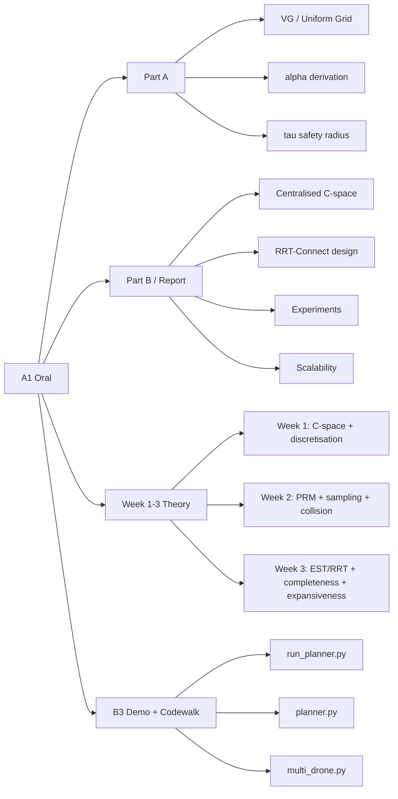
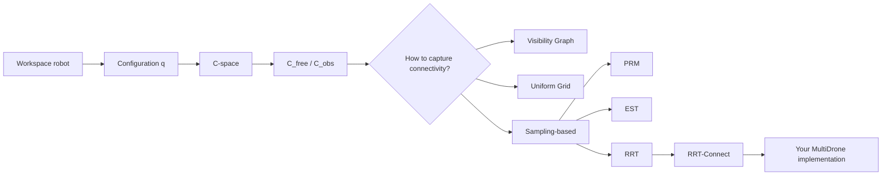
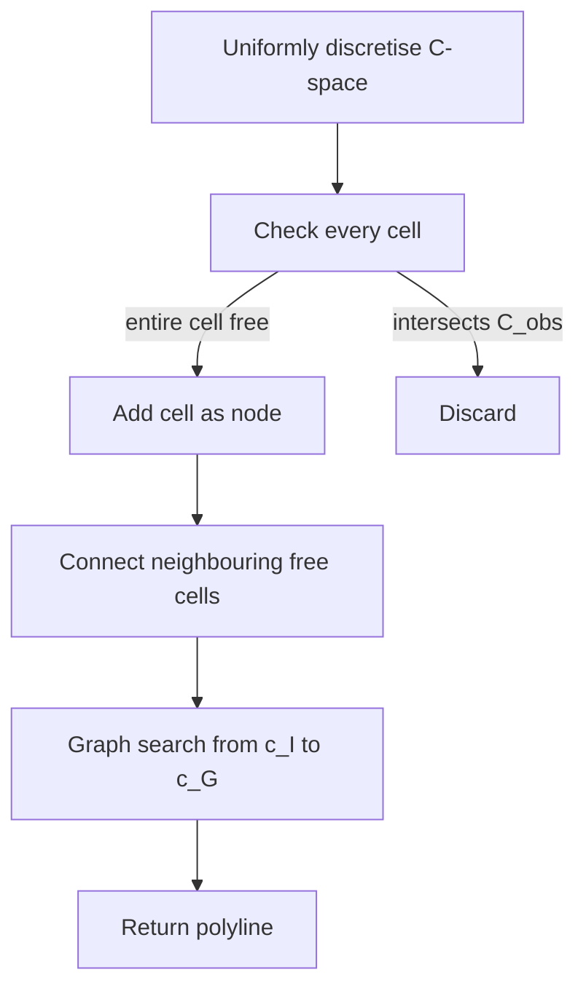
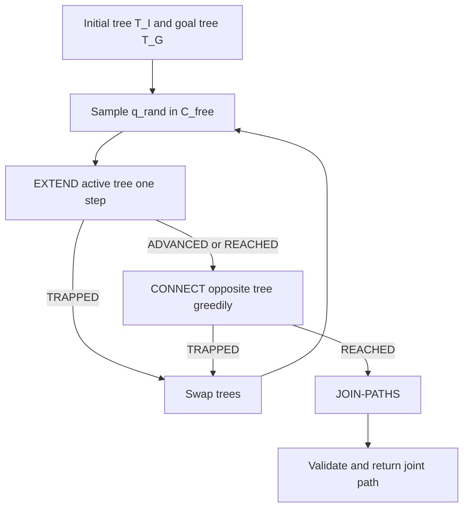
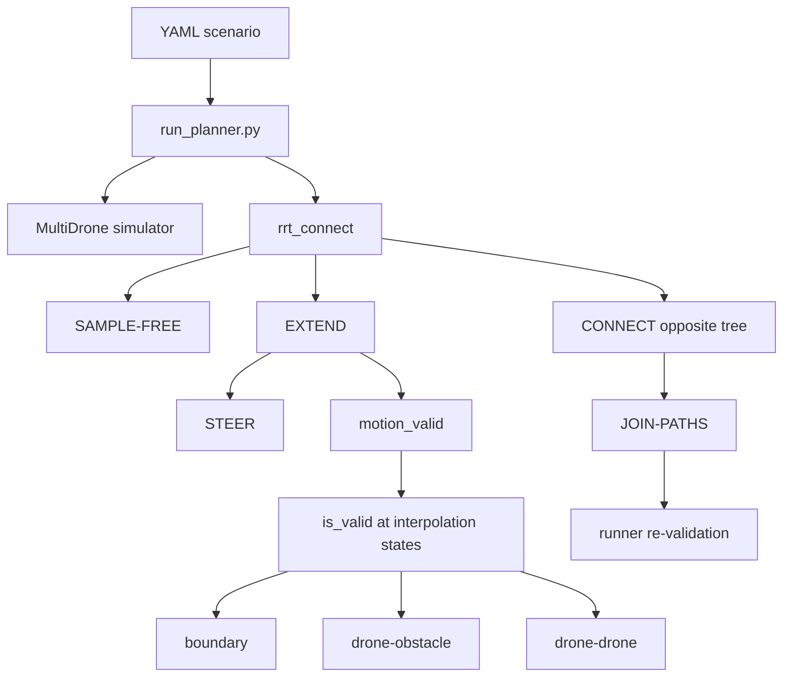
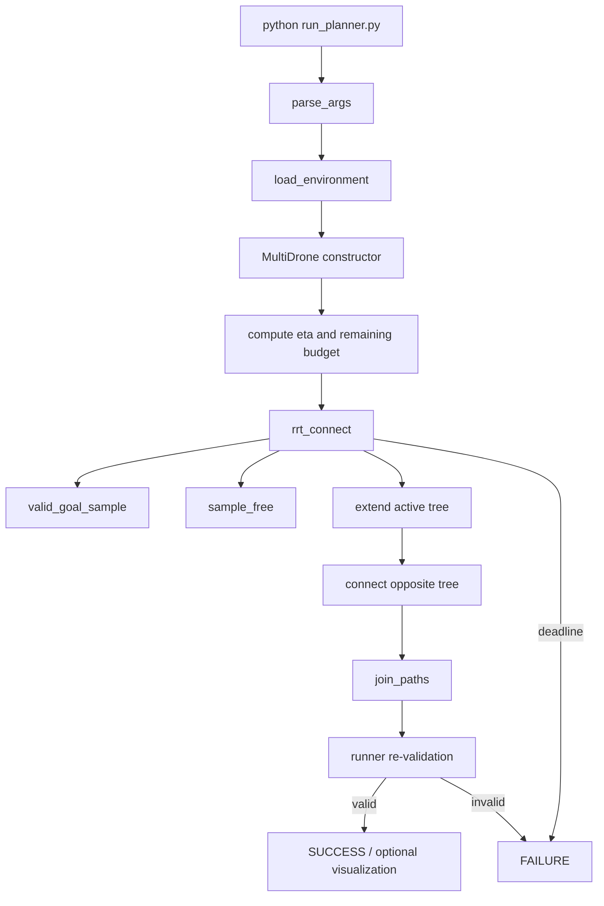

# COMP8620 A1 ORAL MASTER FINAL

> **用途：完整覆盖 A1 in-person Q&A，而不只是 B3 codewalk。** 这一份按官方范围重新组织：**Assignment 1 Part A + Part B + B3 Demo/Codewalk + Week 1–3 lecture/tutorial**。  
> **核心原则：理论问题以 Week 1–3 课件/tutorial 与 A1 题目为准；你自己提交的答案以最终 report 为准；实现问题以真实提交源码为准。**  
> 这份文件整合了此前的 `Oral_QA_Study_Guide` 与真实源码核对后的 `Codewalk_MASTER`。从现在开始可把它作为唯一总复习稿。

---

## 0. 官方范围：先把考试边界搞清楚

A1 specification 明确把 in-person Q&A 分成两部分：

1. **Demo of your program (B3)**；
2. **Oral Q&A related to the assignment and all materials covered in Week 1 to Week 3 (inclusive)**。

其中第二部分单独占 **34 points**。因此只会 RRT-Connect/codewalk 远远不够。

### 0.1 你真正要准备的四层



### 0.2 最重要的知识链



### 0.3 视觉记忆：六张脑图对应六块

#### 图 A：Week 1 世界观

```text
Workspace 中是一个“有形状”的机器人
                |
                v
      用最少参数写成 configuration q
                |
                v
        C-space 中变成一个点
                |
        +-------+-------+
        |               |
      C_free          C_obs
        |               |
        +-------+-------+
                |
                v
       在 C_free 中找连续 path
```

#### 图 B：Part A Q1

```text
Visibility Graph                 Uniform Grid
----------------                 ------------
需要 polygon vertices            不需要 polygon vertices
       |                                |
球半径 k > 0                     把 C-space 划成 cells
       |                                |
obstacle inflation               每个 cell 只问：整格 free 吗？
       |                                |
rounded boundary                       |
       |                                v
standard VG 不直接适用            free cells 建 graph
```

#### 图 C：Part A Q2

```text
K-link arm 最坏 lever arm:
Joint 1 -> P <= KL
Joint 2 -> P <= (K-1)L
...
Joint K -> P <= L

每个 joint angle change <= delta
             |
             v
workspace path <= L*delta*(K+...+1)
             |
             v
alpha = L K(K+1)/2
             |
clearance d_W > alpha*tau
             |
             v
tau < d_W/alpha
```

#### 图 D：Sampling-based 家族

```text
Sampling-based
   |
   +-- Graph-based -------- PRM
   |
   +-- Tree-based
          +-- EST   (bias sparse regions)
          +-- RRT   (global sample -> nearest -> steer)
                 +-- RRT-Connect (two trees + greedy CONNECT)
```

#### 图 E：RRT-Connect

```text
q_rand
  |
  v
Nearest -> Steer -> motion_valid -> Add q_new
                                  |
                                  v
                     opposite tree CONNECT(q_new)
                                  |
                         reached? -- no --> swap trees
                                  |
                                 yes
                                  v
                            JOIN-PATHS
```

#### 图 F：Narrow passage

```text
large region S              other region
+-----------+               +-----------+
|           |---- narrow ---|           |
|           |    passage    |           |
+-----------+               +-----------+

只有入口附近少量 q 能“看出去” -> alpha small
每个 lookout 能看到的新空间少 -> beta small
普通点局部可见空间小          -> epsilon may be small
=> uniform sampling 更难发现 connectivity
```

### 0.4 一个极易混淆点：两个 \(\alpha\)

这门课/A1 中有两个完全不同的 \(\alpha\)：

- **Part A Q2 的 \(\alpha=LK(K+1)/2\)**：C-space distance 到 workspace path length 的 Lipschitz-style upper bound；
- **\((\epsilon,\alpha,\beta)\)-expansiveness 里的 \(\alpha\)**：lookout set 在已探索 connected region 中所占的 measure 比例。

**两者没有同一个物理意义，只是用了同一个希腊字母。**

### 0.5 Source priority / 冲突处理

若不同材料表述略有差异，现场按下面顺序理解：

1. **A1 specification**：决定题目与 oral scope；
2. **Week 1–3 lecture/tutorial**：决定课程概念和术语；
3. **你的最终 report**：决定你书面提交中具体 claim；
4. **你的真实提交源码**：决定 codewalk 中程序实际上做了什么。

特别是 report 与 simulator/code 有少量语义差异时，不要硬说完全一致；后面的源码专项已经逐条列出。

---

# PART I — Assignment + Week 1–3 完整口试理论

> 这一部分是“34 分 Oral Q&A”主干。先彻底掌握，再看后面的真实代码专项。


> 适用范围：Assignment 1 Part A、Part B、B3 程序演示，以及 Week 1-Week 3 lecture/tutorial 全部材料。  
> 目标：不仅能背结论，还能解释定义、推导公式、走读伪代码、分析实验，并回答两层以上追问。

---

### 0. 使用方法

这份笔记把内容分为三档：

- **P0：必须完全掌握。** 与你的报告直接相关，最可能被问；任何一项答不出来都可能明显影响评分。
- **P1：课程核心。** 很可能从 Week 1-Week 3 抽问，也常用于追问你的设计选择。
- **P2：补充与防守。** 概率较低，但能用于应对老师继续深挖。

标记说明：

- **[课件]**：直接来自 lecture slides。
- **[Tutorial]**：直接来自 tutorial 或 tutorial solution。
- **[报告]**：直接来自你的最终报告。
- **[高概率追问｜推断]**：根据题目、报告和口试形式推测，不是官方题库。

课程管理材料明确强调：学生应能解释并 defend 所有提交内容；若书面作业与现场解释存在显著差异，可能触发额外核查。因此复习目标应是“理解并能重建”，而不是只背文字。

---

## 1. 优先级总表

### P0：必须彻底掌握

- [ ] **P0-1** Configuration、C-space、DOF、workspace、forbidden region、free space
- [ ] **P0-2** Visibility Graph 与 Uniform Grid：适用条件、为什么一问 No、一问 Yes
- [ ] **P0-3** Part A 2(a)：从任意 material point 推导 \(\alpha\)
- [ ] **P0-4** Part A 2(b)：由 clearance 推导安全邻域 \(\tau\)
- [ ] **P0-5** Centralised multi-drone C-space 与 \(C_{\mathrm{free}}\)
- [ ] **P0-6** 你的 bidirectional RRT-Connect：每行伪代码、每个函数、每个状态
- [ ] **P0-7** `is_valid`、`motion_valid`、local planner、为什么端点合法不代表边合法
- [ ] **P0-8** Narrow passage 与 \((\epsilon,\alpha,\beta)\)-expansiveness
- [ ] **P0-9** B4 实验：每组环境为什么这样设计、结果说明什么、不说明什么
- [ ] **P0-10** B5 scalability：\(3K\)、\(O(K^2)\)、\(O(NK)\)、sample efficiency
- [ ] **P0-11** B3 代码运行与防守：goal-region sampling、deadline、路径验证、failure case

### P1：课程核心

- [ ] **P1-1** Deterministic motion planning 的假设
- [ ] **P1-2** PRM：roadmap construction、query、四个组件
- [ ] **P1-3** PRM、EST、RRT、RRT-Connect 的本质区别
- [ ] **P1-4** Probabilistic completeness 与 one-sided guarantee
- [ ] **P1-5** Uniform、obstacle-based、bridge-test、workspace-informed sampling
- [ ] **P1-6** Connection strategy：radius、degree limit、lazy checking
- [ ] **P1-7** Collision geometry：AABB、orientation、line-segment intersection、BVH
- [ ] **P1-8** Fixed-step、subdivision、distance-based local collision checking
- [ ] **P1-9** Centralised 与 decoupled multi-robot planning

### P2：补充与防守

- [ ] **P2-1** \(S^1\)、\((S^1)^K\)、\(SE(2)\)、\(SE(3)\)
- [ ] **P2-2** 角度周期性与 wrap-around
- [ ] **P2-3** Generalised Visibility Graph
- [ ] **P2-4** Bounding volume overlap 为什么“不确定”，separation 为什么“确定”
- [ ] **P2-5** 95% CI 的严格统计解释、censoring、success-rate CI
- [ ] **P2-6** Optional bridge / local-bridge 与报告 baseline 的一致性

---

## 2. P0-1：Configuration、C-space、DOF 与 Motion Planning

### 2.1 Deterministic motion planning 的问题定义

**[课件]** Motion planning 研究如何让机器人计算从给定 initial state 到 goal state 的运动，并假设：

1. action effect 是 deterministic 且完全已知；
2. environment 完全已知；
3. robot starting point 精确已知。

因此 Week 1-3 讨论的是“perfect world”中的连续空间规划，不涉及 perception uncertainty、actuation uncertainty 或 belief space。

#### 15 秒口试回答

> Deterministic motion planning asks for a collision-free motion from a known initial state to a goal, assuming the robot dynamics or motion effect and the environment are perfectly known and the initial state is known exactly.

#### 常见陷阱

- 不要把这部分说成 MDP/POMDP；那是后续课程内容。
- 不要说 motion planning 只适用于物理机器人；课程把 simulated agents 也纳入扩展 robot 概念。

---

### 2.2 Configuration 是什么

**[课件]** Configuration 是一个参数，能够完全确定机器人上每一个点的位置；希望用最少数量的参数表示。


definition：

\[
q=\text{a minimal parameter vector that completely specifies the robot pose/shape}.
\]

Configuration space：

\[
C=\{\text{all possible robot configurations}\}.
\]

一个 configuration 是 C-space 中的一个点。

Degrees of Freedom：

\[
\dim(C)=\text{DOF}.
\]

#### 例子

##### 二维 point robot

\[
q=(x,y),\qquad C=\mathbb R^2,\qquad \dim C=2.
\]

##### 平面 \(K\)-joint chain

\[
q=(\theta_1,\ldots,\theta_K),\qquad \dim C=K.
\]

##### 只允许三维平移的 drone

\[
p=(x,y,z)\in\mathbb R^3,\qquad \dim C=3.
\]

#### 高概率追问

**Q：为什么“物体是 3D”不代表 C-space 是 3D？**

因为 C-space 维度由允许独立变化的 configuration parameters 决定，而不是由物体几何维度决定。例如球体虽然是 3D，但若球心只能在固定平面平移，则只有 \((x,y)\) 两个参数。

---

### 2.3 Workspace 与 C-space 的区别

#### Workspace

机器人实际存在和运动的物理空间。

#### C-space

所有可能 configurations 构成的参数空间。

机器人在 workspace 中是一整个几何体；在 C-space 中被表示为一个点。


---

### 2.4 Forbidden region 与 free space

机器人在 configuration \(q\) 时所占据的 workspace 区域记为 \(R(q)\)。

Forbidden region：

\[
C_{\mathrm{obs}}
=
\{q\in C\mid R(q)\cap Obs\neq\varnothing\}.
\]

Free space：

\[
C_{\mathrm{free}}=C\setminus C_{\mathrm{obs}}.
\]

Motion planning 变成寻找连续路径：

\[
\gamma:[0,1]\to C_{\mathrm{free}},
\]

满足：

\[
\gamma(0)=q_I,\qquad \gamma(1)=q_G.
\]

#### 高概率追问

**Q：collision-free constraint 只能表示障碍物吗？**

不能。C-space validity 还可以编码 joint limits、workspace boundaries、dangerous regions、inter-robot collisions 等约束。

---

## 3. P0-2：Visibility Graph 与 Uniform Grid

## 3.1 Visibility Graph 的适用条件

**[课件]** Visibility Graph 假设规划空间中的 obstacles / forbidden regions 是 polygons。

Graph nodes：

\[
V=\{q_I,q_G,\text{polygon vertices}\}.
\]

Graph edges 表示：

- polygon boundary edges；或
- 两个 vertices 间 collision-free 的 straight-line visibility connection。

若 edge weight 是路径长度，则可在图中搜索 Euclidean shortest path。

Naive complexity：

\[
\text{construction time}=O(n^3),\qquad \text{space}=O(n^2),
\]

其中 \(n\) 是障碍物顶点总数。

---

### 3.2 为什么 VG 依赖 polygon vertices

在二维 polygonal obstacles 中：

- free-space 内部的弯曲路径可被拉直；
- 在 straight obstacle edge 中间发生无必要转折也可被拉直；
- shortest path 的必要 bends 出现在 polygon vertices。

因此有限个 vertices 足以形成离散图。

对于 curved boundary，关键绕行点可能是任意 tangent point，而不是有限个 polygon vertices，因此课件中的 polygon-vertex VG 构造不再直接成立。

---

### 3.3 Part A 1(a)：为什么答案是 No

**[报告]** 球半径 \(k>0\)，所以不是 point robot。

机器人中心只能在固定平面 \(\Pi\) 上平移：

\[
q=(x,y),\qquad C\subseteq\mathbb R^2.
\]

对 polyhedral obstacle \(O\)：

\[
C_{\mathrm{obs}}
=
\{q\in C\mid R(q)\cap O\neq\varnothing\}.
\]

更严格地：

\[
C_{\mathrm{obs}}
=
(O\oplus B_k^3)\cap\Pi,
\]

其中 \(B_k^3\) 是半径 \(k\) 的 3D ball。

推理链：

\[
O\text{ polyhedral},\ k>0
\Rightarrow
O\oplus B_k^3\text{ has rounded edge/vertex regions}
\]

\[
\Rightarrow
(O\oplus B_k^3)\cap\Pi\text{ generally contains curved arcs}
\]

\[
\Rightarrow C_{\mathrm{obs}}\text{ generally non-polygonal}
\]

\[
\Rightarrow
\text{polygonal-forbidden-region assumption is violated}
\]

\[
\boxed{\Rightarrow\text{Visibility Graph cannot be applied directly.}}
\]

#### 30 秒标准回答

> No. Visibility Graph requires polygonal forbidden regions and uses their vertices as graph nodes. Since the robot has radius \(k>0\), we must plan in C-space. Inflating a polyhedral obstacle by the sphere radius creates rounded edge and vertex regions; intersecting this inflated obstacle with the motion plane generally produces curved arcs. Therefore the C-space forbidden region is generally non-polygonal, so the required condition is violated.

#### 高概率追问

**Q：转到 C-space 后不还是 Visibility Graph 吗？**

是。对 non-point robot，转 C-space 是 VG 的必要步骤。真正失败的是转完后 forbidden regions 一般不再 polygonal。

**Q：有没有其他 VG 可以处理曲边？**

存在通过 tangency/supporting structures 处理 curved boundaries 的 generalised variants；但这不是课件中定义的 polygon-vertex VG。

---

### 3.4 Uniform Grid 为什么可以

**[课件]** Uniform Grid 不要求 obstacles / forbidden regions 是 polygons，也不需要显式构造 forbidden-region boundary。

将 C-space 划分为 uniform cells。保留完全 free 的 cells：

\[
\operatorname{FREE\mbox{-}CELL}(c)
\Longleftrightarrow
\forall q\in c,\ R_k(q)\cap Obs=\varnothing
\Longleftrightarrow
c\cap C_{\mathrm{obs}}=\varnothing.
\]

构图：

- node = free cell；
- edge = 两个相邻 free cells；
- 找包含 initial/goal 的 cells；
- graph search；
- 连接 initial、cell centres、goal。



#### 为什么路径安全

- square cell 是 convex；initial 到本 cell centre 的 segment 留在 cell 内；
- 相邻 cell centres 的 segment 分别位于两个 free cells 中，并通过公共边；
- 所有 retained cells 完全 obstacle-free。

#### 主要局限

若 cell width \(h\) 太大，narrow passage 中可能不存在一个“完整 free cell”，即使连续路径存在也会被离散化遗漏。

若每维划分 \(m\) 格、维数为 \(d\)：

\[
\text{number of cells}=m^d,
\]

所以高 DOF 下遭遇 curse of dimensionality。

#### 高概率追问

**Q：为什么不能只检查 cell centre？**

因为 centre free 不保证 cell 其他部分 free，路径可能穿过 cell 内未检查的障碍。报告采用的是“整个 cell free”的安全定义。

---

## 4. P0-3：Part A 2(a) - \(\alpha\) 的完整推导

题目给定 C-space metric：

\[
d_C(q,q')=\max_{1\le i\le K}|\theta_i-\theta_i'|.
\]

要求证明机器人上任意点的 workspace path length 满足：

\[
\ell(P)\le \alpha d_C(q,q').
\]

并找出用 \(L,K\) 表示的有效上界 \(\alpha\)。

---

### 4.1 定义角度变化与最大变化

\[
\Delta\theta_i=\theta_i'-\theta_i,
\]

\[
\delta=d_C(q,q')=\max_i|\Delta\theta_i|.
\]

因此：

\[
|\Delta\theta_i|\le\delta,\qquad i=1,\ldots,K.
\]

---

### 4.2 参数化 C-space 直线路径

\[
q(s)=q+s(q'-q),\qquad s\in[0,1].
\]

所以：

\[
\theta_i(s)=\theta_i+s\Delta\theta_i,
\qquad
\dot\theta_i(s)=\Delta\theta_i.
\]

---

### 4.3 取任意 material point

取第 \(m\) 根 link 上任意 material point \(P\)，其中 \(1\le m\le K\)。

只有 upstream joints \(i\le m\) 会影响 \(P\)。

令：

\[
r_i(P,s)=\text{configuration }q(s)\text{ 下 }P\text{ 到 joint }i\text{ 的距离}.
\]

最保守的 lever-arm 上界：

\[
r_i(P,s)\le(m-i+1)L.
\]

---

### 4.4 单个 joint 的弧长贡献

微小参数变化 \(ds\) 导致：

\[
|d\theta_i|=|\Delta\theta_i|ds.
\]

若只考虑 joint \(i\)，点 \(P\) 绕 joint \(i\) 作圆周运动，微小弧长：

\[
d\ell_i(P,s)=r_i(P,s)|\Delta\theta_i|ds.
\]

---

### 4.5 多个 joint 同时运动

真实速度向量是各 joint 诱导速度向量的和。由三角不等式：

\[
\left\|\sum_i v_i\right\|
\le
\sum_i\|v_i\|.
\]

因此：

\[
\ell(P)
\le
\int_0^1\sum_{i=1}^{m}r_i(P,s)|\Delta\theta_i|ds.
\]

代入两个上界：

\[
r_i(P,s)\le(m-i+1)L,
\qquad
|\Delta\theta_i|\le\delta,
\]

得到：

\[
\ell(P)
\le
L\delta\sum_{i=1}^{m}(m-i+1).
\]

而：

\[
\sum_{i=1}^{m}(m-i+1)
=1+2+\cdots+m
=\frac{m(m+1)}2.
\]

因此：

\[
\ell(P)
\le
\frac{Lm(m+1)}2\delta
\le
\frac{LK(K+1)}2\delta.
\]

代回 \(\delta=d_C(q,q')\)：

\[
\boxed{
\ell(P)
\le
\frac{LK(K+1)}2d_C(q,q')
}
\]

所以一个对机器人所有点都成立的有效上界是：

\[
\boxed{
\alpha=\frac{LK(K+1)}2
}.
\]

---

### 4.6 快速直觉

最坏点是末端附近。它受所有 joints 影响：

\[
KL|\Delta\theta_1|
+(K-1)L|\Delta\theta_2|
+\cdots
+L|\Delta\theta_K|.
\]

每个 \(|\Delta\theta_i|\le\delta\)：

\[
\ell\le L\delta(K+(K-1)+\cdots+1)
=\frac{LK(K+1)}2\delta.
\]

这个直觉适合 20 秒回答；正式证明要使用 arbitrary material point。

---

### 4.7 高概率追问

#### Q：为什么不能只证明 end-effector？

题目要求 all points on the robot。取任意 link 上任意 material point 才能完成统一保证；最后才用 \(m\le K\) 得到全机器人上界。

#### Q：为什么 contributions 可以直接相加？

真实位移速度向量可能方向不同；三角不等式保证其模不超过各贡献模的和，因此得到保守上界。

#### Q：这个 \(\alpha\) 是最紧上界吗？

不一定。它是 valid upper bound。推导忽略了不同 joint-induced velocity 之间可能的抵消，因此通常保守。

#### Q：为什么直接用 \(|\theta_i'-\theta_i|\)，不考虑 wrap-around？

物理 rotational joint 属于 \(S^1\)，但题目明确给定该 metric；报告按题目定义推导。若实现一般 rotational planning，通常使用 shortest angular difference。

---

## 5. P0-4：Part A 2(b) - 安全邻域 \(\tau\)

给定：

\[
Neigh(q)=\{q'\mid d_C(q,q')\le\tau\}.
\]

目标：找一个 \(\tau\)，使任何 \(q'\in Neigh(q)\) 都能沿 C-space straight line 从 \(q\) 无碰撞移动到 \(q'\)。

---

### 5.1 路径上任一点与起点的 C-space 距离

\[
q(s)=q+s(q'-q),\qquad s\in[0,1].
\]

则：

\[
d_C(q,q(s))
=
\max_i s|\theta_i'-\theta_i|
=
sd_C(q,q')
\le s\tau
\le\tau.
\]

---

### 5.2 转换为 workspace 最大运动

由 Part 2(a)，从 \(q\) 到路径中间点 \(q(s)\)，机器人任意点的 workspace path length：

\[
\le \alpha d_C(q,q(s))
\le\alpha\tau.
\]

位移不超过路径长度，所以每个 robot point 的 displacement 也不超过 \(\alpha\tau\)。

---

### 5.3 用初始 clearance 保证安全

初始 workspace clearance：

\[
d_W(q,Obs).
\]

移动后最小距离最多减少 \(\alpha\tau\)：

\[
d_W(q(s),Obs)
\ge
 d_W(q,Obs)-\alpha\tau.
\]

要保证整个路径严格无碰撞：

\[
d_W(q,Obs)-\alpha\tau>0.
\]

因此：

\[
\boxed{
\tau<\frac{d_W(q,Obs)}{\alpha}
}
\]

代入：

\[
\alpha=\frac{LK(K+1)}2,
\]

得到：

\[
\boxed{
\tau<\frac{2d_W(q,Obs)}{LK(K+1)}
}.
\]

允许的 guaranteed radii 的 supremum：

\[
\boxed{
\tau_{\sup}=\frac{d_W(q,Obs)}{\alpha}
}.
\]

---

### 5.4 为什么必须严格小于

若：

\[
\alpha\tau=d_W(q,Obs),
\]

只能推出：

\[
d_W(q(s),Obs)\ge0.
\]

可能恰好接触 obstacle。若 contact 算 collision，则等号不提供严格安全保证。又因为 \(Neigh(q)\) 包含边界 \(d_C=\tau\)，所以应写：

\[
0\le\tau<\frac{d_W(q,Obs)}{\alpha}.
\]

#### 与 Week 3 local planner 的联系

该推导本质上提供一个 adaptive collision-checking certificate：若 configuration-space step 足够小，使最大 workspace displacement 小于当前 clearance，则该 step 无需更密集采样即可证明安全。

---

## 6. P0-5：Centralised Multi-Drone C-space

### 6.1 单架无人机

每架 drone 只允许 translation：

\[
p_i=(x_i,y_i,z_i)\in\mathbb R^3.
\]

半径为 \(r\) 的 bounding sphere：

\[
B_r(p_i).
\]

---

### 6.2 Admissible centre region

bounded workspace 为 \(W\)。

仅要求 \(p_i\in W\) 不够，因为球心可能在内、sphere 却穿出 boundary。

定义：

\[
W_r=\{p\in W\mid B_r(p)\subseteq W\}.
\]

---

### 6.3 Centralised joint configuration

将 \(K\) 架无人机当作一个 composite robot：

\[
q=(p_1,\ldots,p_K).
\]

联合 C-space：

\[
\boxed{
C=W_r^K\subseteq\mathbb R^{3K}
}
\]

\[
\boxed{\dim C=3K}.
\]

例如 \(K=5\)：

\[
q\in\mathbb R^{15}.
\]

---

### 6.4 Joint free space

相同半径 \(r\) 时：

\[
C_{\mathrm{free}}
=
\left\{
q\in C\ \middle|\
\begin{aligned}
&B_r(p_i)\cap Obs=\varnothing,&&i=1,\ldots,K,\\
&\|p_i-p_j\|_2>2r,&&1\le i<j\le K
\end{aligned}
\right\}.
\]

约束来源：

1. workspace boundary 已由 \(W_r\) 编码；
2. 每架 drone 不撞静态障碍；
3. 任意两架 drone 不互撞。

若半径不同，更一般为：

\[
\|p_i-p_j\|_2>r_i+r_j.
\]

报告实验使用相同 radius，因此 \(2r\) 自洽。

---

### 6.5 Centralised 的优缺点

#### 优点

- 所有 drones 的协调在一个 state 中表示；
- inter-drone collision 是普通 validity constraint；
- 一条联合路径同时给出所有 drones 的同步轨迹；
- 不需要先独立规划再修补冲突。

#### 缺点

- dimension 从 3 增至 \(3K\)；
- pair constraints 为 \(\binom K2\)；
- jointly valid / useful samples 的比例下降；
- narrow coordinated transitions 更难采样。

---

### 6.6 高概率追问

**Q：为什么 centralised planning 自动处理 drone-drone collision？**

因为任何包含 overlap pair 的联合 configuration 都不属于 \(C_{\mathrm{free}}\)，而 planner 只在 joint free space 中接受 nodes 和 edges。

**Q：为什么不是 \(C=W^K\)？**

因为需保证整个 sphere 在 workspace 内，所以使用 eroded/admissible centre region \(W_r\)。

**Q：如果 drone 可以旋转呢？**

完整 rigid-body configuration 通常属于 \(SE(3)=\mathbb R^3\times SO(3)\)。本题 bounding sphere 且只允许 translation，所以 orientation 不影响几何，也不是 state variable。

---

## 7. P0-6：你的 Bidirectional RRT-Connect

## 7.1 一句话本质

在 joint \(3K\)-dimensional C-space 中，从 initial 和 valid goal 各生长一棵 tree；每轮一棵树向随机 free sample 扩展一步，另一棵树贪心地反复向该新节点扩展，若两树相连则恢复联合 collision-free path。



---

### 7.2 为什么选 RRT-Connect

**[报告]**

1. 本题是 continuous \(3K\)-dimensional single-query planning；
2. simulator 提供 state/edge validity checking；
3. 双向树和 greedy connect 有利于 20 秒内快速找 feasible path；
4. PRM roadmap reuse 对单次 query 不必要；
5. RRT* 的 path optimisation 不是题目要求，会消耗预算。

#### 30 秒标准回答

> I chose bidirectional RRT-Connect because this is a single-query feasibility problem in a continuous high-dimensional joint space. Two trees reduce the distance that each side must explore, and the Connect operation greedily exploits successful progress. PRM’s reusable roadmap and RRT*’s optimisation overhead are unnecessary under the 20-second feasibility objective.

---

### 7.3 Distance metric

\[
\boxed{
d(q,q')=\max_{1\le i\le K}\|p_i-p_i'\|_2
}
\]

物理含义：联合 transition 中移动最远的 individual drone displacement。

与 joint Euclidean metric 对比：

\[
\|q-q'\|_2
=
\sqrt{\sum_i\|p_i-p_i'\|_2^2}.
\]

Joint Euclidean distance 会随 \(K\) 累积；max metric 直接控制任意单架 drone 的最大步长。

它是合法 metric，因为满足：

- non-negativity；
- identity；
- symmetry；
- triangle inequality（各 component Euclidean metric 的 max）。

---

### 7.4 Steer

\[
\boxed{
\operatorname{Steer}(q,q')
=
q+
\min\left\{1,\frac{\eta}{d(q,q')}\right\}(q'-q)
}
\]

令：

\[
\lambda=
\min\left\{1,\frac{\eta}{d(q,q')}\right\}.
\]

#### Case 1：target 近

\[
d(q,q')\le\eta
\Rightarrow
\lambda=1
\Rightarrow
q_{new}=q'.
\]

#### Case 2：target 远

\[
d(q,q')>\eta
\Rightarrow
\lambda=\frac{\eta}{d(q,q')}.
\]

所以：

\[
d(q,q_{new})=\eta.
\]

对任意 drone \(i\)：

\[
\|p_i^{new}-p_i\|_2
=
\lambda\|p_i'-p_i\|_2
\le
\lambda d(q,q')
\le\eta.
\]

因此：

\[
\boxed{\text{one extension moves every drone by at most }\eta.}
\]

---

### 7.5 \(\eta\) 的意义与 trade-off

报告默认：

\[
\eta=0.05\times\text{workspace diagonal}.
\]

对 \([0,50]^3\)：

\[
\eta=0.05\sqrt{3\cdot50^2}=4.330.
\]

这是 scale-aware heuristic，不是理论最优。

#### 太大

- local edge 更易撞障碍；
- `motion_valid` 一次检查更长、更贵；
- 难以穿过细小几何结构；
- greedy Connect 容易反复 trapped。

#### 太小

- 节点数增加；
- parent chain 变长；
- nearest-neighbour 成本上升；
- 全局探索速度下降。

---

### 7.6 SAMPLE-FREE

Baseline：在 configuration bounds 内 uniform sample：

\[
q_{rand}\sim Uniform(C),
\]

若：

\[
\texttt{sim.is\_valid}(q_{rand})=	ext{False},
\]

则 reject，直到得到：

\[
q_{rand}\in C_{\mathrm{free}}.
\]

注意：uniform in each coordinate 并不等于 uniform over every possible manifold representation；但本题 joint translations 直接用 bounded Euclidean coordinates。

---

### 7.7 NEAREST

\[
q_{near}
=
\arg\min_{v\in T}d(v,q_{target}).
\]

报告实现用 brute-force linear scan。

若 tree 有 \(N\) 个 nodes，每次 metric 比较处理 \(K\) 架 drones：

\[
T_{nearest}=O(NK).
\]

选择 linear scan 的理由：20 秒内 tree 通常是 handful-to-low-hundreds nodes，且 `motion_valid` 成本通常远高于 metric comparison；维护 spatial index 未必回本，高维下 kd-tree 也会退化。

---

### 7.8 EXTEND

核心步骤：

1. \(q_{near}\leftarrow NEAREST(T,q_{target})\)；
2. 若已到 target，返回 `REACHED`；
3. \(q_{new}\leftarrow STEER(q_{near},q_{target},\eta)\)；
4. 若 `motion_valid(q_near,q_new)` 为 False，返回 `TRAPPED`；
5. 否则把 \(q_{new}\) 加入 tree，parent 为 \(q_{near}\)；
6. 到 target 返回 `REACHED`，否则 `ADVANCED`。

三种状态：

| 状态 | 含义 |
|---|---|
| `TRAPPED` | 连一步都无法合法前进 |
| `ADVANCED` | 成功前进一个 step，但未到 target |
| `REACHED` | 已到 target |

伪代码用 `== 0` 和 exact equality 是算法表达；真实 floating-point 实现应使用 tolerance 或依靠 Steer 的 exact target branch。

---

### 7.9 CONNECT

`CONNECT` 重复调用 `EXTEND`：

\[
q_0\to q_1\to q_2\to\cdots
\]

直到：

- `TRAPPED`；
- `REACHED`；
- deadline。

\[
\boxed{
EXTEND=\text{one step},\qquad
CONNECT=\text{repeated EXTEND}
}
\]

这就是 RRT-Connect 相比普通 RRT extension 更贪心的部分。

---

### 7.10 为什么两树交换

本轮：

\[
T_I\to q_{rand},\qquad T_G\to q_{new}.
\]

下一轮 swap 后：

\[
T_G\to q_{rand},\qquad T_I\to q_{new}.
\]

避免一侧一直做探索，保持 bidirectional growth 较均衡。

---

### 7.11 JOIN-PATHS 为什么正确

每个 tree node 保存 parent pointer。

若两树相连：

- 从 meeting node 沿 \(T_I\) parent chain 回到 \(q_I\)；
- 从 meeting node 沿 \(T_G\) parent chain 回到 \(q_G\)；
- 翻转方向并拼接。

因为所有 tree edges 都经过 `motion_valid`，返回 path 是 validated local paths 的串联。

`T_a` 用来判断本轮 active tree 是 initial-rooted 还是 goal-rooted，避免 parent-chain 方向拼错。

---

### 7.12 Goal-region sampling

报告算法：

1. 先取各 drone goal centres 的联合向量 \(q_G\)；
2. 检查：
   \[
   \texttt{sim.is\_valid}(q_G)\land\texttt{sim.is\_goal}(q_G);
   \]
3. 若 centres 组合不合法，则在每架 drone 的 goal region 内各采一点；
4. 仅在联合 state 同时 valid 且满足 goal condition 时接受。

#### 为什么 goal centres 可能 invalid

- 某 centre 可能受 obstacle 影响；
- 多个 centres 可能彼此太近；
- 但 goal regions 中可能仍有其他联合合法配置。

E12 就用于测试该 fallback，25/25 成功。

---

### 7.13 为什么返回路径可靠

完整安全链：

1. initial 合法；
2. goal root 同时 `is_valid` 和 `is_goal`；
3. 每条 tree edge 通过 `motion_valid`；
4. JOIN-PATHS 只拼 validated edges；
5. runner 成功前独立重新检查 initial、每条 consecutive edge、最终 goal。

因此成功返回是 one-sided reliable；Failure 只表示预算内没找到。

---

## 8. P0-7：`is_valid`、`motion_valid` 与 Local Planner

### 8.1 `is_valid(q)`

检查一个 joint configuration 是否属于：

\[
q\in C_{\mathrm{free}}.
\]

Multi-drone 中至少包括：

- 所有 spheres 在 workspace 内；
- 无 static obstacle collision；
- 无 inter-drone collision。

---

### 8.2 `motion_valid(q,q')`

检查整条 local path 是否位于 \(C_{\mathrm{free}}\)。

你的 straight-line joint interpolation：

\[
q(t)=(1-t)q+tq',\qquad t\in[0,1].
\]

对每架 drone：

\[
p_i(t)=(1-t)p_i+tp_i'.
\]

即所有 drones 同步沿各自 workspace straight line 移动。

---

### 8.3 为什么 endpoints valid 不代表 edge valid

可能：

\[
q,q'\in C_{\mathrm{free}},
\]

但：

\[
\exists t\in(0,1):q(t)\in C_{\mathrm{obs}}.
\]

典型例子：两架 drone 交换位置，起点和终点均分离，但同步直线插值会在中间相撞。

\[
\boxed{
\texttt{is\_valid}(q)\land\texttt{is\_valid}(q')
\not\Rightarrow
\texttt{motion\_valid}(q,q')
}
\]

---

### 8.4 Fixed-step collision checking

简单方法：将 segment 离散成很多小段，每段取 midpoint 做 state collision check。

问题：

- step 太大：可能漏掉薄障碍或短 collision interval；
- step 太小：collision checks 数量极大。

---

### 8.5 Week 3 distance-based recursive checking

课件算法：

1. 若 \(q\) 或 \(q'\) collision，返回 collision；
2. 计算它们到最近 forbidden region 的距离 \(d_q,d_{q'}\)，形成空球 \(B_q,B_{q'}\)；
3. 取 midpoint：
   \[
   q_m=(q+q')/2;
   \]
4. 若 \(q_m\) 同时位于两个 clearance balls 中，则 segment 可判 free；
5. 否则递归检查 \(qq_m\) 和 \(q_mq'\)。

Part A 2 的 \(\alpha\)-bound 则提供从 C-space step 到 workspace displacement 的另一种安全界。

---

### 8.6 Local planner 的角色

Sampling-based planner 不显式构造整个 \(C_{\mathrm{free}}\)。它依赖 local planner 回答：

> 这两个 sample 是否能通过简单局部运动直接连接？

所以 local planner 的能力会改变：

- visibility set \(V(q)\)；
- roadmap/tree connectivity；
- narrow passage 难度；
- runtime。

---

## 9. P0-8：Narrow Passage 与 \((\epsilon,\alpha,\beta)\)-Expansiveness

### 9.1 Visibility set

令：

\[
F=C_{\mathrm{free}}.
\]

对 \(q\in F\)：

\[
V(q)
=
\{q'\in F\mid q\text{ can be connected to }q'\text{ by the local planner}\}.
\]

在课件的 straight-line local planner 情况下，就是 segment \(qq'\) 完全位于 free space。

---

### 9.2 \(\epsilon\)-goodness

\[
\boxed{
\mu(V(q))\ge\epsilon\mu(F),\qquad\forall q\in F
}
\]

解释：每个普通点至少能直接看见整个 free space 的 \(\epsilon\) 比例。

\[
\epsilon\text{ 大}\Rightarrow\text{good local visibility}.
\]

---

### 9.3 \(\beta\)-lookout set

对已探索 connected region \(S\subseteq F\)：

\[
\boxed{
LOOKOUT_\beta(S)
=
\{q\in S\mid \mu(V(q)\setminus S)\ge\beta\mu(F\setminus S)\}
}
\]

- \(q\in S\)：当前已探索区域中的点；
- \(V(q)\setminus S\)：从 \(q\) 能看到的新 territory；
- \(\beta\)：一个 lookout 能看见外部剩余空间的多少比例。

\[
\beta\text{ 大}\Rightarrow\text{good outward visibility per lookout}.
\]

---

### 9.4 \((\epsilon,\alpha,\beta)\)-expansive

若：

1. \(F\) 是 \(\epsilon\)-good；
2. 对每个 connected \(S\subseteq F\)：
   \[
   \mu(LOOKOUT_\beta(S))\ge\alpha\mu(S),
   \]

则 \(F\) 是 \((\epsilon,\alpha,\beta)\)-expansive。

\[
\alpha\text{ 大}\Rightarrow\text{there are many lookouts in each explored region}.
\]

---

### 9.5 三参数一句话记忆

| 参数 | 问题 | 高值含义 |
|---|---|---|
| \(\epsilon\) | 每个普通点能看多少？ | local visibility 好 |
| \(\beta\) | 一个 lookout 能看多少新空间？ | outward visibility 好 |
| \(\alpha\) | lookout 有多少？ | 容易采到出口点 |

记忆：

\[
\boxed{
\epsilon=\text{ordinary point visibility},\quad
\beta=\text{new space per lookout},\quad
\alpha=\text{fraction of lookouts}
}
\]

---

### 9.6 为什么 narrow passage 难

取 \(S\) 为通道左侧大区域。

- 只有入口附近很小区域能看到 \(S\) 外：\(\alpha\) 小；
- 从入口可能只能看到通道/右侧很小部分：\(\beta\) 小；
- 有用 sample 占 free-space measure 很小。

因此 uniform random sampling 很难同时：

1. 采到 passage/entrance 附近；
2. 构造足够 local connections 跨越通道。

---

### 9.7 Tutorial Week 3 两图哪个容易

两个 C-space 中单个 narrow passage 的 width/length 相同，但左图有多个 passages，右图只有一个。

左图更容易：

- 总入口 measure 更大；
- 可连接到另一侧的 lookout points 更多；
- route redundancy 更高；
- 更容易采到至少一个成功连接。

因此：

\[
\boxed{
\text{same passage width}\not\Rightarrow\text{same planning difficulty}
}
\]

---

### 9.8 如何选择 \(S\)

**[Tutorial]** 不是随便选一个 \(S\) 算完即可。Expansiveness condition 必须对每个 connected \(S\subseteq F\) 成立；tightest constants 由 worst-case connected subset 决定。

通常存在多个 valid \((\epsilon,\alpha,\beta)\) triples。

---

### 9.9 理论边界

Expansiveness formal analysis 主要用于 PRM/free-space connectivity 的概率分析。

可以说它为你的 RRT-Connect narrow-passage experiments 提供 geometry intuition；不要说它直接严格预测你的 RRT runtime 或成功率。

正确表述：

> The expansiveness framework formally characterises free-space visibility for sampling-based planning, particularly PRM analysis. I use the same geometric intuition to explain why uniform RRT-Connect struggles with low-measure bottlenecks.

---

## 10. P0-9：B4 实验设计、统计与结果解释

## 10.1 Research question

**[报告]** 研究 obstacle density 和 free-space structure 如何影响五架 drones 的 baseline uniform RRT-Connect。

四个 hypotheses：

1. obstacle density 增加会提高 planning time；
2. narrow/sequential passages 降低 finite-time success；
3. 同宽度的多个 alternative passages 比单通道更容易；
4. compound constraints 和 local traps 降低有限预算成功率。

---

### 10.2 Controlled comparisons

| 比较轴 | Environments | 变化因素 | Trials |
|---|---|---|---:|
| Obstacle density | E0-E3 | 0、3、7、14 obstacles，无 critical bottleneck | 25 |
| Passage width | E4 vs E5 | gap width 14 vs 2 | 25 |
| Route redundancy | E5 vs E6 | 1 vs 3 个 width-2 gaps | 25 |
| Offset passages | E7 | 两个 sequential width-2 transitions | 15 |
| Stress tests | E9-E11 | 2D aperture、swap、dead-end | 25 |

固定：

- \(K=5\)；
- 同一 start/goal；
- workspace \([0,50]^3\)；
- radius \(0.3\)；
- \(\eta=4.330\)；
- uniform sampling only；
- 20s timeout；
- sequential runs；
- planner call 单独计时。

固定这些变量是为了减少 confounding，让环境结构成为主要变化因素。

---

### 10.3 Metrics

#### Success

在 20 秒内返回并通过独立 path validation。

#### Capped runtime

失败 run 保留其 timeout time（约 20s）。

它衡量的是实际 20 秒运行政策下的 operational cost，而不是成功 runs 的 conditional mean solve time。

#### Mean 和 95% Student-t CI

\[
\boxed{
\bar t\pm t_{0.975,n-1}\frac{s}{\sqrt n}
}
\]

- \(\bar t\)：sample mean；
- \(s\)：sample standard deviation；
- \(n\)：runs；
- population variance 未知，所以使用 Student-t。

正确解释：若重复相同的采样与构区间过程，约 95% 的这些区间会覆盖真实均值。不是“95% 的单次运行落在区间内”。

---

### 10.4 报告结果表

| Env | Structure | Success | Capped runtime |
|---|---|---:|---:|
| E0 | Empty | 25/25 | \(0.04\pm0.00\) s |
| E1 | Sparse | 25/25 | \(0.12\pm0.01\) s |
| E2 | Moderate | 25/25 | \(0.32\pm0.07\) s |
| E3 | Dense | 25/25 | \(1.03\pm0.19\) s |
| E4 | Wide passage | 25/25 | \(0.16\pm0.03\) s |
| E5 | Narrow passage | 20/25 | \(10.19\pm2.67\) s |
| E6 | Three narrow passages | 25/25 | \(2.95\pm0.50\) s |
| E7 | Offset sequential passages | 1/15 | \(19.38\pm1.35\) s |
| E9 | Coupled y-z aperture | 0/25 | \(20.00\pm0.00\) s |
| E10 | Bottleneck + drone swap | 22/25 | \(7.97\pm2.38\) s |
| E11 | Dead-end trap | 0/25 | \(20.00\pm0.00\) s |

---

### 10.5 E0-E3：Obstacle density

所有 100% success，但 runtime：

\[
0.04\to1.03s.
\]

解释：

- 更多 obstacles 提高 invalid sample rejection；
- `motion_valid` 更容易发现 collision，局部检查工作增加；
- 但 free space 仍有 broad alternative routes，没有关键 bottleneck，因此成功率保持 100%。

结论：raw obstacle count 会增加工作量，但不单独决定规划难度。

---

### 10.6 E4 vs E5：Passage width

\[
100\%\to80\%,
\qquad
0.16s\to10.19s.
\]

原因：通道宽度缩小后，有用 configurations / local connections 的 relative measure 显著下降；对应 \(\alpha,\beta\) 直觉变差。

---

### 10.7 E5 vs E6：Route redundancy

E5：一个 width-2 gap，20/25。  
E6：三个 width-2 gaps，25/25。

虽然每个 passage 同样窄，多个 alternatives 提供更多 lookout opportunities 和失败后的替代路线。

这直接呼应 Tutorial Week 3 的多通道图。

---

### 10.8 E7：Sequential offset passages

只 1/15 成功。

原因：必须完成两次不同位置的 low-measure transition：

\[
S_1\to S_2\to S_3.
\]

进入中间区域并不意味着第二个出口容易被发现；两次困难事件组合使 finite-time success 急剧下降。

---

### 10.9 E9、E11：0 success 不等于 infeasible

报告对 E9、E11 构造 explicit waypoint witnesses，并逐 state/edge 用：

- `is_valid`；
- `motion_valid`

验证。

因此：

\[
\boxed{\text{feasible path exists}}
\]

而 baseline 0/25 的含义是：

\[
\boxed{\text{uniform RRT-Connect failed within 20s}}
\]

不是 no solution。

这与 probabilistic planner 的 one-sided nature 完全一致。

---

### 10.10 E10：Bottleneck + swap

22/25 success，说明该具体实验中 planner 仍经常能解决联合 order reversal。

安全结论：bottleneck 仍是主要困难来源。

不要说：

> 加了 swap 反而让问题更简单。

E10 22/25 与 E5 20/25 的差异可能只是有限样本随机波动，且环境不一定只差一个因素，不能过度因果解释。

---

### 10.11 Limitation 必会

你的报告主动承认：

- 一个 start-goal set；
- 固定 \(K=5\)；
- 固定 planner parameters；
- 20s cutoff；
- E0-E3 并非 perfectly nested；
- E7 trials 更少。

所以：

\[
\boxed{\text{results are comparative, not universal}}
\]

#### 高概率追问

**Q：为什么 E7 只有 15 次？**

因为多数 runs 达到 20 秒，计算成本高；这使统计精度低于 25-trial groups，报告已显式承认。

**Q：为什么 success rate 没有 CI？**

报告满足“至少 mean + 95% CI”的要求是通过 runtime；success 给出 count/rate。更严格研究可给 Wilson/binomial CI，应承认这是可改进点。

**Q：为什么 20.00±0.00 不代表确定？**

因为所有 observations 被相同 20 秒 timeout right-censor；零 sample variance 只说明 capped observations 一样，不说明潜在 solve time 没随机性。

---

## 11. P0-10：B5 Scalability

### 11.1 Dimension

\[
\boxed{\dim C=3K}.
\]

| \(K\) | Dimension |
|---:|---:|
| 1 | 3 |
| 2 | 6 |
| 3 | 9 |
| 4 | 12 |
| 5 | 15 |

---

### 11.2 Collision-check cost

Drone-obstacle checks：

\[
O(K).
\]

Inter-drone pairs：

\[
\binom K2
=
\frac{K(K-1)}2
=
O(K^2).
\]

`motion_valid` 还需沿 local path 多次重复 state checking，因此 edge cost 随 interpolation count 进一步增加。

---

### 11.3 Nearest-neighbour cost

Brute-force tree 有 \(N\) 个 nodes。

每个 metric evaluation：

\[
O(K).
\]

扫描整个 tree：

\[
\boxed{O(NK)}.
\]

Node storage：

\[
O(NK).
\]

---

### 11.4 Sample efficiency

随着 \(K\) 增大，一个 joint sample 必须同时满足：

- \(K\) 个 obstacle/boundary conditions；
- \(\binom K2\) 个 pair conditions；
- passage 中可能要求多架 drones 协调位置。

因此 jointly valid sample fraction 和 useful coordinated region 的 relative measure 往往下降。

这通常是比“dimension 线性增加”更关键的实际瓶颈。

---

### 11.5 E8 实验

E8 无 static obstacles，但反转 drone order，使 direct joint segment invalid。

| \(K\) | Dim | Pair constraints | Success | Runtime |
|---:|---:|---:|---:|---:|
| 2 | 6 | 1 | 25/25 | \(21.72\pm0.61\) ms |
| 3 | 9 | 3 | 25/25 | \(34.84\pm1.40\) ms |
| 4 | 12 | 6 | 25/25 | \(44.68\pm4.27\) ms |
| 5 | 15 | 10 | 25/25 | \(54.32\pm3.79\) ms |

从 \(K=2\) 到 5，mean runtime 约增加 2.5 倍。

---

### 11.6 为什么没有测 \(K=1\)

\(K=1\) dimension 为 3，pair constraints 为 0；但 E8 的“swap/order reversal”至少需要两架 drones。因此实验从 \(K=2\) 开始，同时报告理论上解释了 \(K=1\)。

---

### 11.7 为什么 runtime 没有指数爆炸

- \(K\le5\) 范围小；
- E8 无 static obstacles；
- useful free-space measure 仍较大；
- 该实验主要测 open-scene coordination，不是 cluttered narrow passage 的极端高维 regime。

因此不能用 E8 证明 centralized planning 一般只线性增长。

正确结论：在 required \(K\in[1,5]\) 的 open scenes 中实现 practical；cluttered coordinated passages 中 sample efficiency 和 repeated collision checks 更可能成为主导瓶颈。

---

## 12. P0-11：B3 代码演示与防守

### 12.1 你必须能现场说明的命令

最简：

```bash
python3 run_planner.py --environment <scenario.yaml> --visualize
```

默认：

- infer \(K\)；
- time limit 20s；
- seed 0；
- scaled \(\eta\)；
- uniform baseline；
- 可打开 3D viewer。

---

### 12.2 B3 最可能现场检查

1. zip 解压后路径结构是否保留；
2. 是否只依赖实验室已安装 libraries；
3. 能否读取 simulator-format YAML；
4. hidden scenario 的 \(K\) 是否正确推断；
5. 20 秒内是否 return；
6. success path 是否真的 valid；
7. impossible/no-solution case 是否会 hang；
8. goal centres invalid 时是否能从 goal regions 找到 valid goal。

---

### 12.3 E12 与 E13 的意义

#### E12

Goal centres 本身 invalid，但 goal regions 存在 valid joint goal。

结果：25/25，\(0.06\pm0.01\) s。

证明：goal-region fallback 工作，不把“centre invalid”错误当成整个 goal impossible。

#### E13

Initial cluster 被封闭 box 包围。

10/10 返回 Failure，无 hang，无 invalid path，约 20.01s（不含 simulator setup）。

证明：finite deadline 和 no-solution handling 工作。

现场风险：题目写 up to 20 seconds，外部 wall-clock 可能包含 Python return/validation overhead。代码内部应留少量 margin，而不是恰好把全部 20.000s 用完。

---

### 12.4 Optional bridge 参数如何解释

CLI 提供：

- `--bridge-prob`；
- `--bridge-sigma`；
- `--local-bridge`。

但：

\[
\boxed{\text{default bridge-prob}=0}
\]

所以：

- B2 伪代码是 baseline uniform RRT-Connect；
- B4 experiments 明确使用 uniform only；
- bridge 是 optional sampling enhancement，不改变 EXTEND/CONNECT/path validation 核心结构。

若开启 mixed sampling，应保留 nonzero uniform component，以维持全局 coverage/completeness intuition。

---

## 13. P1-1：PRM

### 13.1 本质

Sampling-based planning 不显式构造完整 forbidden/free-space geometry，而是用 graph/tree 紧凑表示 free-space connectivity。

PRM 是 graph-based、multiple-query 方法。

---

### 13.2 Roadmap construction

重复：

1. sample configuration \(q\)；
2. 若 \(q\) collision-free，加入 roadmap vertex；
3. 找附近 vertices \(q'\)；
4. 若 local path \(qq'\) collision-free，加入 edge；
5. 直到 time/sample stopping criterion。

---

### 13.3 Query phase

1. 将 initial 接入一个可见 roadmap vertex；
2. 将 goal 接入 roadmap；
3. graph search；
4. roadmap edge sequence 对应连续 local paths。

也可 interleave construction 和 search，直到找到 query path 或 timeout。

---

### 13.4 四个核心组件

1. Sampling strategy；
2. Connection strategy；
3. State validity checking；
4. Local-path / segment validity checking。

课件强调：segment collision check 往往最耗时；sampling strategy 对 scalability 很重要。

---

### 13.5 PRM vs RRT-Connect

| 属性 | PRM | RRT-Connect |
|---|---|---|
| 结构 | graph/roadmap | two trees |
| 典型用途 | multiple-query | single-query |
| 构建目标 | 近似整个 free-space connectivity | 尽快连接特定 start-goal |
| Search | roadmap graph search | tree connection + parent recovery |
| 本题适合性 | roadmap reuse 不明显 | 更符合 20s single-query |

---

## 14. P1-2：EST、RRT 与 RRT-Connect

### 14.1 EST

**[课件]**

1. initial 为 tree root；
2. 选择 tree node \(q\)，概率与其邻域密度成反比：
   \[
   P(q)\propto\frac1{N(q)},
   \]
   其中 \(N(q)\) 是距离 \(D\) 内 tree nodes 数量；
3. 在 \(q\) 的距离 \(D\) 邻域内 local uniform sample \(q'\)；
4. 若 state 和 segment valid，加入 child；
5. 通常 bidirectional。

本质：优先扩展 sparse / underexplored regions。

---

### 14.2 RRT

1. global uniform sample \(q_{rand}\)；
2. 找 nearest tree node \(q_{near}\)；
3. 在 \(q_{near}q_{rand}\) 方向找距离不超过 \(D\) 的 \(q_{new}\)；
4. local segment valid 则加入；
5. 通常可双向。

RRT 的 exploration 来自 nearest-neighbour 产生的 Voronoi bias：拥有大 Voronoi region 的边界节点更容易被选中。

---

### 14.3 RRT-Connect

在 bidirectional RRT 基础上，一棵树 extension 成功后，另一棵树对该 node 重复 Extend，直到 reached/trapped。

\[
\boxed{\text{RRT-Connect = bidirectional RRT + greedy repeated connect}}
\]

---

## 15. P1-3：Probabilistic Completeness

### 15.1 定义

若存在 valid path：

\[
\boxed{
\lim_{n\to\infty}
P(\operatorname{fail}(n,q_I,q_G))=0
}
\]

其中 \(n\) 是 roadmap/tree milestones 数量或计算资源规模。

直观：给足够时间，找到已有路径的概率趋近 1。

---

### 15.2 它不保证什么

不保证：

- finite time 一定成功；
- 返回 Failure 就证明无解；
- 找到 shortest/optimal path；
- 任意 biased sampler 自动保持 completeness。

课件指出 original PRM、EST、RRT 的 failure probability 随 \(n\) 增加可指数下降；对偏置 sampling 需要谨慎确保仍保留必要 coverage。

---

### 15.3 One-sided planner

若返回经过验证的 solution：

\[
\Rightarrow \text{可以相信它正确}.
\]

若返回 Failure：

\[
\not\Rightarrow \text{问题无解}.
\]

可能只是还没有找到。

E9/E11 是报告中的直接例子。

---

### 15.4 Disconnection proof

证明 no solution 的问题称为 disconnection proofs；课件指出仍是相对开放问题。不要把 sampling timeout 当成 disconnection proof。

---

## 16. P1-4：Sampling Strategies

### 16.1 Uniform sampling

优点：

- 简单；
- global coverage；
- 容易保留 completeness 条件。

缺点：

- narrow passage relative measure 小；
- 大量 sample 落在不重要 open regions 或 collision regions；
- runtime variance 大。

---

### 16.2 Obstacle-based / Gaussian-like sampling

课件方法：

1. uniform sample \(q_1\)；
2. 在 \(q_1\) 的距离 \(D\) 内 sample \(q_2\)；
3. 若一端 collision、一端 free，保留 free 端。

目的：bias samples toward obstacle boundary，因为 narrow passages 常位于障碍物边界附近。

---

### 16.3 Bridge Test

1. sample \(q_1\)；
2. 在其附近 sample \(q_2\)；
3. 若二者都 collision；
4. 检查 midpoint：
   \[
   q_m=0.5(q_1+q_2);
   \]
5. 若 \(q_m\) free，保留 \(q_m\)。

直觉：两个 collision endpoints 位于狭窄 passage 两侧障碍物内部，中点可能正落在通道。

局限：

- 参数 \(D/\sigma\) 敏感；
- open region 可能效率低；
- 纯 bridge sampling 可能损害全局 coverage，所以常和 uniform 混合。

---

### 16.4 Workspace-informed sampling

课件思路：

1. 将机器人简化为 workspace point；
2. 在 2D/3D workspace grid 中找粗 path \(\pi\)；
3. 从 \(\pi\) 的 cells 采 workspace point \(p\)；
4. 再采能使机器人某个参考点 \(r\) 位于 \(p\) 的 configurations。

用 workspace geometry 给高维 C-space sampling 提供 bias。

---

### 16.5 Combining sampling strategies

简单方法：固定 mixture weights。

课件还讲 multi-armed bandit：

- 每个 arm = 一个 sampling strategy；
- exploration vs exploitation；
- epsilon-greedy；
- EXP3。

可能奖励：某 strategy 产生的新 sample/edges 是否连接了不同 roadmap components 或改善 connectivity。

---

## 17. P1-5：Connection Strategy

### 17.1 为什么不连接 all pairs

- \(O(n^2)\) candidate edges；
- long edges collision-check 更贵；
- long edges 更可能穿过 forbidden region。

---

### 17.2 Radius / nearest-neighbour connection

只尝试连接距离小于 \(D\) 的 vertices。

#### \(D\) 太小

- 需要更多 samples 才能连通；
- roadmap 易碎片化。

#### \(D\) 太大

- 接近 all-pairs；
- expensive collision checking；
- 大量失败 long edges。

还可限制每个 vertex 的 degree 或只连 \(k\)-nearest。

---

### 17.3 Lazy strategy

先把 nearby candidate edges 加入图，不立即 collision check；只有 graph search 真正需要某条 edge 时再检查。

优点：避免检查永远不会用于 query 的 edges。

代价：搜索期间可能反复发现 invalid edges，需要删除后重新搜索。

---

## 18. P1-6：Collision Geometry

### 18.1 Axis-aligned rectangles

两个 AABB 不碰撞，只要至少有一个 separating condition：

- A 完全在 B 左边；
- A 完全在 B 右边；
- A 完全在 B 上方；
- A 完全在 B 下方。

若四个 separating cases 都不成立，则 overlap/collision。

---

### 18.2 Orientation test

三点 \(a,b,c\) 的 signed area determinant：

\[
\operatorname{Area}(a,b,c)
=
\begin{vmatrix}
a_x&a_y&1\\
b_x&b_y&1\\
c_x&c_y&1
\end{vmatrix}.
\]

- \(>0\)：counterclockwise；
- \(<0\)：clockwise；
- \(=0\)：collinear。

---

### 18.3 Segment intersection

一般情况，segments \(p_1q_1\) 与 \(p_2q_2\) intersect 若：

1. \(p_1q_1p_2\) 与 \(p_1q_1q_2\) orientation 不同；
2. \(p_2q_2p_1\) 与 \(p_2q_2q_1\) orientation 不同。

Collinear special cases 还需检查 x/y projections 是否 overlap。

可先用两个 segments 的 AABB 做 cheap rejection，只有 bounding boxes overlap 才做 orientation test。

---

### 18.4 Tutorial Week 2 结果

给定 AB、CD、EF：

- AB 与 EF 相交；
- AB 与 CD 不相交；
- CD 与 EF 不相交。

重点不是背答案，而是能现场用 determinant signs 说明。

---

### 18.5 Hierarchical Bounding Volumes

为对象构造 tree：

- leaf：包围一个 primitive（segment/triangle）；
- root：包围整个对象；
- 越靠上 bounding volume 越粗。

Collision traversal：

1. 检查 roots；
2. 若 separated，直接无碰撞；
3. 若 overlap，向较大 volume 的 children 展开；
4. 到 leaf 才检查 exact primitives。

核心逻辑：

\[
\boxed{
\text{bounding volumes separated}\Rightarrow\text{objects definitely separated}
}
\]

但：

\[
\boxed{
\text{bounding volumes overlap}\not\Rightarrow\text{objects definitely collide}
}
\]

Overlap 只是不确定，需要继续细化。

同一结构也可做 distance computation：若一个 subtree 的 bounding-volume lower bound 已不可能优于当前 best distance，就 prune。

---

## 19. P2：C-space Topology

### 19.1 Rotational joint 与 \(S^1\)

一个完整旋转角具有周期性：

\[
0\equiv2\pi.
\]

所以自然 configuration space 是 unit circle：

\[
S^1.
\]

\(K\) 个 rotational joints：

\[
(S^1)^K.
\]

Tutorial solution 对 bounded/unbounded 7-joint static manipulator 都给出 \((S^1)^7\)，并说明计算实现常映射到 \(\mathbb R^7\)，但边界/wrap-around 需要特别处理。

---

### 19.2 \(SE(2)\)

平面 rigid robot：

\[
q=(x,y,\theta),
\]

自然空间：

\[
SE(2)=\mathbb R^2\times S^1.
\]

三个 centralised planar circular robots：

\[
SE(2)^3,
\]

计算 embedding 常写成 \(\mathbb R^9\)。

---

### 19.3 \(SE(3)\)

3D rigid body：

\[
SE(3)=\mathbb R^3\times SO(3),
\]

包含 3 translational + 3 rotational DOFs。

本作业 drone 只 translation 且用 sphere，所以只需 \(\mathbb R^3\)。

---

### 19.4 Mobile manipulator

Tutorial solution：7-DOF arm + 可旋转 wheelchair base：

\[
(S^1)^7\times SE(2).
\]

Nonholonomic movement restriction 不改变 configuration 的最小参数集合；它应作为 motion constraint / validity 或 local-planner constraint，而不是删除 pose variable。

---

## 20. 报告最可能被问的 50 个问题与标准回答

以下问题为**高概率追问推断**，不是官方题库。

### A. 总体与算法

#### 1. 用 30 秒解释你的 planner。

> I plan in the joint \(3K\)-dimensional C-space using bidirectional RRT-Connect. Each iteration uniformly samples a valid joint configuration, extends one tree by at most \(\eta\), and greedily connects the opposite tree to the new node. All accepted edges pass `motion_valid`. If the trees meet, I join their parent chains and independently revalidate the returned path.

#### 2. 为什么是 centralised，而不是每架 drone 分别规划？

> The assignment explicitly asks for centralised planning. A joint configuration contains all drone centres, so inter-drone collisions become C-space validity constraints and coordination is handled directly.

#### 3. 为什么选 RRT-Connect？

> It is a single-query feasibility problem under a 20-second budget. Bidirectional greedy connection focuses computation on linking the given endpoints; PRM reuse and RRT* optimisation are unnecessary.

#### 4. 为什么不用 PRM？

> PRM is most useful when the same roadmap serves many queries in a fixed scenario. Here the goal is one start-goal query, so constructing a reusable global roadmap is less efficient.

#### 5. 为什么不用 RRT*？

> The marking criterion is feasibility within 20 seconds, not path optimality. RRT* spends additional time rewiring and improving path cost.

#### 6. 你的 metric 为什么合理？

> It equals the maximum displacement among all drones and directly bounds every individual drone’s movement during an extension.

#### 7. 证明 Steer 每架 drone 移动不超过 \(\eta\)。

\[
\|p_i^{new}-p_i\|
=
\lambda\|p_i'-p_i\|
\le
\lambda d(q,q')
\le\eta.
\]

#### 8. \(\eta=5\%\) 是理论最优吗？

> No. It is a scale-aware heuristic. It avoids a fixed value tied to one workspace size, but optimal tuning is environment-dependent.

#### 9. \(\eta\) 太大会怎样？

> More local edges collide, collision checking becomes more expensive, and narrow structures are harder to enter.

#### 10. \(\eta\) 太小会怎样？

> The tree needs many nodes and nearest-neighbour queries, parent chains become long, and global exploration slows.

#### 11. 为什么用 linear nearest search？

> The trees remain small under the 20-second budget and motion validation dominates cost. A spatial index has overhead and degrades in high dimensions.

#### 12. `EXTEND` 和 `CONNECT` 区别？

> EXTEND attempts one step. CONNECT repeatedly calls EXTEND until it reaches the target, becomes trapped, or times out.

#### 13. 为什么 swap trees？

> To alternate exploratory growth from the start and goal sides and keep bidirectional growth balanced.

#### 14. 为什么先检查 direct `motion_valid(q_I,q_G)`？

> If the direct joint interpolation is valid, it is already the simplest feasible path and building trees is unnecessary.

#### 15. 两个 endpoints 都 valid，为什么还要 `motion_valid`？

> Intermediate configurations can collide with obstacles or other drones. State validity does not imply edge validity.

#### 16. 为什么 returned path 一定 collision-free？

> Every stored edge passes `motion_valid`; parent chains consist only of stored edges; the runner rechecks every edge before reporting success.

#### 17. Failure 说明无解吗？

> No. It only means the planner did not find a path within the finite budget.

#### 18. Goal centre invalid 是什么情况？

> The centres may collide with obstacles or with one another, while other points inside the goal regions may form a valid joint goal.

#### 19. 为什么 goal sample 要同时检查 `is_valid` 和 `is_goal`？

> `is_valid` guarantees collision freedom; `is_goal` guarantees the state satisfies the requested goal regions. Neither alone is sufficient.

#### 20. Optional bridge 是否让 B2 伪代码与代码不一致？

> No for the baseline. The default bridge probability is zero and B4 uses uniform sampling. Bridge sampling is an optional replacement for Sample-Free, while EXTEND, CONNECT and path validation remain unchanged.

---

### B. Part A

#### 21. 为什么 3D sphere 的 C-space 是 2D？

> Only the two planar centre coordinates vary; object geometry is 3D but its allowed DOFs are two.

#### 22. VG 不满足哪一个条件？

> The C-space forbidden regions are generally non-polygonal, while the taught VG uses polygon vertices as graph nodes.

#### 23. 为什么 obstacle polyhedral，forbidden region 却不是 polygonal？

> Minkowski inflation by a ball rounds edges and vertices; the intersection with the motion plane generally contains curved arcs.

#### 24. 转 C-space 不就解决了吗？

> Moving to C-space is necessary but not sufficient. The resulting forbidden-region geometry still violates the polygonal condition.

#### 25. Uniform Grid 为什么不受曲边影响？

> It only needs a whole-cell free/occupied test and does not rely on an explicit polygonal boundary representation.

#### 26. Uniform Grid 有 completeness 吗？

> It can be resolution-complete relative to the chosen discretisation, but a coarse grid can miss a real narrow passage.

#### 27. \(\alpha\) 为什么是三角数？

> The worst point is affected by lever arms \(KL,(K-1)L,\ldots,L\); summing them gives \(L K(K+1)/2\).

#### 28. 为什么 \(\alpha\) 只是 upper bound？

> The derivation sums magnitudes and ignores vector cancellation, so it is conservative.

#### 29. 为什么 \(\tau\) 不能取等号？

> Equality only guarantees zero clearance, and contact counts as collision; the closed neighbourhood includes the boundary.

#### 30. Part A 2 和 local planner 有什么关系？

> It converts a C-space step into a guaranteed bound on workspace motion, allowing clearance-based certification of collision-free local motion.

---

### C. Experiments

#### 31. 为什么 E0-E3 障碍物更多但仍 100%？

> The environments remain broadly connected without critical bottlenecks. Extra obstacles increase rejection and collision-check work, but alternative routes remain abundant.

#### 32. 为什么 E5 突然困难？

> Narrowing the gap reduces the relative measure of useful samples and local connections near the passage.

#### 33. 为什么 E6 比 E5 更容易？

> Three alternative narrow gaps increase route redundancy and the number of useful lookout configurations.

#### 34. 为什么 E7 最难之一？

> It requires two sequential offset bottleneck transitions; success at the first does not expose the second directly.

#### 35. E9/E11 0/25 是否无解？

> No. Independently validated waypoint witnesses establish feasibility; zero success is finite-time planner failure.

#### 36. 为什么设置 same start/goal？

> To control the query and isolate the effect of environment structure.

#### 37. 为什么多个 seeds？

> Sampling-based runtime and success are random; repeated seeds estimate performance variability rather than one lucky run.

#### 38. 95% CI 是什么？

> It quantifies uncertainty in the estimated mean across repeated trials; it is not the range containing 95% of individual runtimes.

#### 39. 为什么 failed runs 记 20s？

> To report capped operational runtime under the actual timeout policy and penalise failure rather than condition only on successful runs.

#### 40. 20.00±0.00 是否说明稳定？

> It mainly reflects right-censoring at a common timeout, not absence of latent runtime variability.

#### 41. 为什么 E7 只有 15 trials？

> Most runs consumed the full timeout, so the experiment was more expensive. The lower sample size reduces precision and is reported as a limitation.

#### 42. 你的实验能推广到所有场景吗？

> No. They are controlled comparative results for one query, selected parameters, \(K=5\) and a 20-second budget.

#### 43. E10 比 E5 success 更高是否说明 swap 有帮助？

> No. The difference can be sampling variability and the scenes are not a clean proof of that causal claim. The safe conclusion is that the bottleneck remains dominant.

---

### D. Scalability

#### 44. 为什么 dimension 是 \(3K\)？

> Each translating drone contributes three centre coordinates and centralised planning uses their Cartesian product.

#### 45. 为什么 collision checking 是 \(O(K^2)\)？

> There are \(\binom K2\) inter-drone pairs, in addition to \(O(K)\) obstacle checks.

#### 46. 为什么 nearest 是 \(O(NK)\)？

> A brute-force query scans \(N\) tree nodes and each distance evaluation processes \(K\) drones.

#### 47. 为什么 K 增加 sampling efficiency 会下降？

> A joint sample must satisfy all individual and pair constraints simultaneously; useful coordinated passage configurations occupy a smaller relative volume.

#### 48. 为什么 E8 不放 static obstacles？

> To isolate dimension and inter-drone coordination from obstacle clutter.

#### 49. 为什么 E8 没指数爆炸？

> It is an open scene with only \(K\le5\); it does not exercise the severe narrow-passage regime where high-dimensional sample inefficiency becomes dominant.

#### 50. Centralised 最大的本质问题是什么？

> Not merely more coordinates, but the shrinking relative measure of jointly valid and useful coordinated configurations together with repeated pairwise collision checking.

---

## 21. 绝对不能说错的 20 句话

1. 不能说 3D sphere 必然有 3D C-space。
2. 不能说 workspace 与 C-space 是同一个空间。
3. 不能说两个 valid endpoints 之间一定是 valid edge。
4. 不能说 sampling planner Failure 证明 no solution。
5. 不能说 RRT-Connect 返回 optimal path。
6. 不能说 obstacle count 单独决定 difficulty。
7. 不能说 same passage width 就一定同样难。
8. 不能说 Uniform Grid 对连续问题 exact complete。
9. 不能说 \(\eta=5\%\) 是理论最优。
10. 不能说 E9/E11 infeasible。
11. 不能说 95% CI 包含 95% 单次 observations。
12. 不能说 \(20.00\pm0.00\) 表示 runtime 没随机性。
13. 不能说 expansiveness theorem 直接预测你的 RRT runtime。
14. 不能说所有 curved-obstacle VG 都不存在。
15. 不能说 bridge sampling 是 B4 baseline。
16. 不能说 centralised 没有维度代价。
17. 不能说 `is_goal` 自动保证 collision-free。
18. 不能说 `is_valid` 自动保证整条 local motion free。
19. 不能说你的 \(\alpha\) 一定是 tightest possible constant。
20. 不能说 E8 证明 runtime 对 \(K\) 一般只线性增长。

---

## 22. 公式速查表

### C-space

\[
C_{\mathrm{obs}}
=
\{q\in C\mid R(q)\cap Obs\neq\varnothing\}
\]

\[
C_{\mathrm{free}}=C\setminus C_{\mathrm{obs}}
\]

### Multi-drone

\[
q=(p_1,\ldots,p_K),
\qquad
C=W_r^K\subseteq\mathbb R^{3K}
\]

\[
W_r=\{p\in W\mid B_r(p)\subseteq W\}
\]

\[
\|p_i-p_j\|_2>2r
\]

### RRT-Connect

\[
d(q,q')=\max_i\|p_i-p_i'\|_2
\]

\[
Steer(q,q')
=
q+
\min\left\{1,\frac\eta{d(q,q')}\right\}(q'-q)
\]

### Part A 2

\[
\alpha=\frac{LK(K+1)}2
\]

\[
\ell(P)\le\alpha d_C(q,q')
\]

\[
\tau<\frac{d_W(q,Obs)}\alpha
=
\frac{2d_W(q,Obs)}{LK(K+1)}
\]

### Expansiveness

\[
V(q)=\{q'\in F:q\text{ connects locally to }q'\}
\]

\[
\mu(V(q))\ge\epsilon\mu(F)
\]

\[
LOOKOUT_\beta(S)
=
\{q\in S:\mu(V(q)\setminus S)\ge\beta\mu(F\setminus S)\}
\]

\[
\mu(LOOKOUT_\beta(S))\ge\alpha\mu(S)
\]

### Probabilistic completeness

\[
\lim_{n\to\infty}P(FAIL(n,q_I,q_G))=0
\]

### Statistics

\[
\bar t\pm t_{0.975,n-1}\frac{s}{\sqrt n}
\]

### Complexity

\[
\binom K2=\frac{K(K-1)}2=O(K^2)
\]

\[
T_{nearest}=O(NK)
\]

---

## 23. 四轮模拟口试方案

### Round 1：30 秒定义题

不看资料回答：

1. Configuration / C-space / DOF；
2. \(C_{obs}\) / \(C_{free}\)；
3. Visibility Graph condition；
4. PRM；
5. RRT；
6. probabilistic completeness；
7. \(\epsilon,\alpha,\beta\)；
8. centralised C-space。

目标：每题 20-30 秒，先给结论，再给一条原因。

---

### Round 2：白板推导

必须从空白开始写出：

1. \(\alpha=LK(K+1)/2\)；
2. \(\tau<d_W/\alpha\)；
3. Steer 每架 drone movement \(\le\eta\)；
4. pair constraints 数量 \(\binom K2\)；
5. 95% Student-t CI。

---

### Round 3：代码走读

从 `run_planner.py` 入口开始说明：

1. YAML load；
2. infer \(K\)；
3. set seed / \(\eta\) / deadline；
4. valid goal sampling；
5. RRT-CONNECT main loop；
6. EXTEND；
7. CONNECT；
8. JOIN-PATHS；
9. independent validation；
10. visualization / failure return。

目标：老师指任意函数，都能说 input、output、invariant、failure mode。

---

### Round 4：反驳型问题

练习回答：

- “你这个方法 0/25，所以是不是算法错了？”
- “为什么 E10 比 E5 更高，swap 难道有帮助？”
- “你的 CI 为什么不给 success rate？”
- “为什么不用 PRM/RRT*？”
- “你怎么证明 edge 安全？”
- “你的 \(\alpha\) 真的是最小值吗？”
- “为什么 exact equality 在代码里不会有浮点问题？”
- “如果 goal centre invalid，你是不是改了题目的 goal？”
- “Optional bridge 是否和报告伪代码不一致？”

回答原则：

1. 先承认问题边界；
2. 区分理论结论和实验观察；
3. 不过度 claim；
4. 回到代码/定义/验证证据。

---

## 24. 建议复习顺序

### 第 1 阶段：统一语言

\[
Configuration
\to C\text{-space}
\to C_{obs}
\to C_{free}
\to joint\ C\text{-space}
\]

### 第 2 阶段：你的算法

\[
Sample
\to Nearest
\to Steer
\to EXTEND
\to CONNECT
\to Swap
\to JOIN\text{-}PATHS
\]

### 第 3 阶段：安全性

\[
is\_valid
\to motion\_valid
\to local\ planner
\to \alpha
\to \tau
\]

### 第 4 阶段：采样理论

\[
PRM
\to sampling\ strategies
\to probabilistic\ completeness
\to expansiveness
\to narrow\ passage
\]

### 第 5 阶段：实验与 scalability

\[
controlled\ experiment
\to repeated\ seeds
\to capped\ runtime
\to CI
\to limitations
\to K\text{-scaling}
\]

---

## 25. 来源索引

本笔记以以下已上传材料为基础：

1. `week1-classAdmin.pdf`
   - 课程范围、assessment、必须解释和 defend 提交内容、GenAI disclosure。
2. `week1-Intro.pdf`
   - deterministic motion planning、configuration、C-space、DOF、forbidden/free space、Visibility Graph、Uniform Grid。
3. `week2-SamplingBasedMP.pdf`
   - PRM、roadmap construction/query、sampling strategies、connection strategies、collision geometry、hierarchical bounding volumes。
4. `week3-SamplingBasedMP-Cont.pdf`
   - local segment checking、EST、RRT、probabilistic completeness、one-sided guarantee、expansiveness。
5. `tutorial-w2.pdf` 与 `tutorial-w2-SolEx.pdf`
   - C-space examples、\(S^1/SE(2)/SE(3)\)、line-segment intersection、workspace collision checking。
6. `tutorial-w3.pdf`
   - 多 narrow passages 与单 passage 的难度比较、MultiDrone primitives。
7. `tutorial-w3-lectureRecap.pdf`
   - \(\epsilon\)-goodness、\(\beta\)-lookout、\(\alpha\)-expansiveness 及 tutorial questions。
8. `a1.pdf`
   - Assignment 1 题目、分值与 oral scope。
9. `u8076655_A1_report(1).pdf`
   - 你的最终 Part A/B 推导、RRT-Connect 设计、E0-E13、B4/B5 数据和 limitations。

---

## 26. 最后检查清单

提交/口试前确保：

- [ ] 能不看报告讲完整 RRT-Connect；
- [ ] 能手推 \(\alpha\) 和 \(\tau\)；
- [ ] 能解释每一个 E0-E13 的目的；
- [ ] 能解释 95% CI，但不误解；
- [ ] 能明确区分 Failure 与 infeasible；
- [ ] 能现场运行一条命令；
- [ ] 能说明 `is_valid` 与 `motion_valid`；
- [ ] 能解释 goal-region fallback；
- [ ] 能说明 bridge options 默认关闭；
- [ ] 能说明报告 limitation，不夸大结论；
- [ ] `AI_prompts.txt` 完整包含所有 prompts/intermediate records；
- [ ] zip 解压后可在 lab machine 独立运行；
- [ ] 内部 deadline 给 20 秒外部总时间留出退出/验证余量。


---

# PART II — 真实提交源码 Codewalk / Demo 专项

> **这一部分解决的是 B3 demo 与老师指着代码追问。**  
> 前面的理论章节告诉你“算法为什么成立/课程讲了什么”；这里告诉你“你的提交到底具体怎么实现”。  
> 如果理论与源码有差异，以这里记录的真实代码行为回答 codewalk；不要反过来用源码细节篡改课程定义。

### 进入这一部分前，只记住一句

```text
Theory: sampling-based planner needs valid states + valid local motions.
Code:   is_valid(q) handles a state; motion_valid(q0,q1) checks the candidate edge.
```




> **用途**：A1 in-person demo / code walkthrough 的唯一主复习稿。  
> **最终依据**：`u8076655_A1_code.zip`、`u8076655_A1_report(2).pdf`、A1 specification、Week 1–3 lecture/tutorial，以及此前两份准备材料。  
> **使用原则**：从现在开始优先看这一份；前两份只作为历史备份，不需要并行复习。代码相关结论以真实提交源码为准，旧稿中所有“待源码确认”的内容已被替换。

---

## 0. 怎么用这份 MASTER

### 0.1 Codewalk 现场本质上要回答六个问题

1. **Input 如何进入程序？**
2. **联合 configuration 如何表示？**
3. **RRT-Connect 主循环怎样从 start / goal 生长两棵树？**
4. **什么条件下 node 和 edge 才会被接受？**
5. **两树相遇后，为什么 returned path 方向正确且有效？**
6. **困难或无解场景下，为什么程序会按预算退出而不是 hang？**

现场最危险的不是少背一个术语，而是解释不清：

- `run_planner.py` 与 `planner.py` 的职责；
- `EXTEND` 与 `CONNECT` 的区别；
- `a_is_init` / tree orientation 为什么存在；
- goal centre invalid 时的 fallback；
- `motion_valid` 为什么不能被 endpoints validity 替代；
- Failure 为什么不等于 infeasible；
- 20 秒 deadline 实际保证到了什么程度；
- optional bridge 与默认 baseline 的关系。

### 0.2 复习优先级

**第一轮（P0，必须脱稿）**：

```text
90秒总览
→ 文件调用链
→ (K,3) joint configuration
→ distance / steer
→ EXTEND / CONNECT
→ rrt_connect 主循环
→ is_valid / motion_valid / is_goal
→ path recovery + correctness
→ deadline / Failure
```

**第二轮（P0，源码防守）**：

```text
goal fallback
→ duplicate meeting node
→ exact equality
→ theoretical model vs simulator semantics
→ fixed-step local planner
→ bridge default / local_bridge
→ experiments / complexity
```

**第三轮（P1）**：

```text
Week 1–3 理论联系
→ hidden scenarios
→ 40 个问答
→ 5 分钟现场话术
→ 一页速记
```

### 0.3 真实源码核对后的 8 个关键事实

1. **meeting configuration 会重复一次。** `join_paths` 直接拼接两条都包含 meeting node 的 branch，形成零长度 edge；安全但冗余。
2. **`valid_goal_sample` 没有显式调用 `sim.is_goal`。** 但采样构造本身保证每架 drone 在对应 goal ball 内，runner 最后仍会调用 `is_goal`。
3. **`CONNECT` 开头的 `nearest` 不完全是无意义的。** 若 deadline 在第一次 `EXTEND` 前已经到达，它给 `TIMEOUT` 准备一个合法返回 node；正常情况下随后确实会重复一次 nearest search。
4. **浮点 exact equality 在此实现中基本可解释。** 因为 `steer` 在目标距离不超过 `eta` 时直接返回 `q_target.copy()`，所以 `np.array_equal` 对 `REACHED` 分支是可控的。
5. **`motion_valid` 是固定步长离散检查，不是精确 continuous collision detection。** 应说“相对于 supplied primitive 验证有效”，不要说数学上绝对连续安全。
6. **理论报告与 simulator 的 boundary/contact 语义不完全相同。** 报告使用 `W_r` 和严格 `>2r`；simulator 实际只检查球心在 bounds 内，并允许两球恰好距离 `2r`。
7. **20 秒是 best-effort 外部预算，不是源码层面的严格证明。** runner 留了 `0.3s` margin，但 final validation 没纳入打印的 `total_elapsed`，单次 `motion_valid` 也可能跨过 deadline。
8. **源码注释说 Bridge Test 没在 Week 1–3 讲过，这是错的。** Week 2 slides 明确列出 Uniform、Obstacle-based、Bridge Test。口试不要重复该注释。

---

## 1. 90 秒总览答案

### 1.1 英文标准版本

> My implementation plans in the joint configuration space. A configuration is a NumPy array of shape `(K, 3)`, so one node simultaneously stores the 3D positions of all drones. `run_planner.py` loads the YAML file, infers `K`, constructs the supplied simulator, computes the extension length as five percent of the workspace diagonal, and calls `rrt_connect` with the remaining wall-clock budget.
>
> The planner grows two trees, one rooted at the initial joint configuration and one at a valid joint goal sample. In each iteration, it uniformly samples a valid joint configuration, extends the active tree by one bounded step, and then greedily calls `CONNECT` on the opposite tree toward the new node. A node is added only when the corresponding edge passes `sim.motion_valid`.
>
> If the trees meet, the planner traces both parent chains, orients them from initial to goal, and returns their concatenation. The runner independently rechecks the initial state, every consecutive motion, and the final goal condition before printing success. If the deadline is reached first, it returns failure; this is finite-time failure, not a proof of infeasibility.

### 1.2 中文逻辑链

1. YAML 给出 workspace、obstacles、start、goals；  
2. runner 构建 simulator 并计算参数；  
3. planner 在 `(K,3)` 的联合 state 上生长两棵树；  
4. 一侧 `EXTEND` 一步，另一侧 `CONNECT` 多步；  
5. 每条 edge 必须通过 `motion_valid`；  
6. 相遇后沿 parent pointers 拼路径；  
7. runner 再验证；  
8. 超时则返回 `None`。

这条链可以压缩成：

\[
\boxed{
\text{load}
\rightarrow
\text{joint-space RRT-Connect}
\rightarrow
\text{validated parent-chain path}
\rightarrow
\text{success or timed failure}
}
\]

---

## 2. 实际文件结构与调用链

### 2.1 关键文件

| 文件 | 实际职责 | 现场一句话 |
|---|---|---|
| `run_planner.py` | CLI、YAML、构造 simulator、计算 `eta`、分配预算、调用 planner、最终验证与输出 | orchestration layer |
| `planner.py` | `distance`、`steer`、sampling、nearest、`EXTEND`、`CONNECT`、双树主循环、path recovery | planning core |
| `multi_drone.py` | supplied simulator；state validity、discrete motion validity、goal test、visualization | geometry/validity oracle |
| `environments/*.yaml` | start、bounds、obstacles、goal balls | problem instances |
| `results/run_experiments.py` | 批量运行 B4/B5 experiments | experiment driver |
| `results/validate_hard_cases.py` | 独立验证 E9/E11 waypoint witnesses | feasibility witness checker |
| `results/experiment_results.csv` | 每次 trial 的结果 | raw data |
| `results/summary_table.csv` | 汇总 success/runtime/CI | report summary |

### 2.2 调用图



### 2.3 最简单的文件区分回答

> `run_planner.py` handles the interface and execution policy; `planner.py` contains the RRT-Connect algorithm; `multi_drone.py` supplies the state, motion and goal-validity primitives.

---

## 3. 数据表示：代码里一个 configuration 到底长什么样

### 3.1 联合 configuration

单架 drone：

\[
p_i=(x_i,y_i,z_i).
\]

`K` 架 drone 的联合 state：

\[
q=(p_1,\ldots,p_K).
\]

代码实际使用：

```python
q.shape == (K, 3)
```

例如 `K=5`：

```text
q = [
  [x1, y1, z1],
  [x2, y2, z2],
  [x3, y3, z3],
  [x4, y4, z4],
  [x5, y5, z5],
]
```

数学上维数仍然是：

\[
\dim(C)=3K.
\]

只是实现没有 flatten 成 `(3K,)`，而是保留更自然的 `(K,3)` 形状。

### 3.2 `Node`

`planner.py:16–21`：

```python
class Node:
    __slots__ = ("config", "parent")
```

每个 node 只保存：

- `config`：一个 `(K,3)` joint configuration；
- `parent`：同一棵树中指向父节点的 reference。

没有保存：

- children list；
- cost-to-come；
- rewiring 信息；
- heuristic；
- collision status cache。

因此它是普通 RRT-Connect tree node，不是 RRT* node。

### 3.3 Tree 的实际类型

每棵树就是：

```python
list[Node]
```

`nearest` 对整个 list 做 linear scan。parent pointers 负责恢复 root-to-node path。

### 3.4 代码中的 tree invariant

对任意 tree node `v`：

1. root 的 configuration 是有效的；
2. 非 root node 的 parent 已经在 tree 中；
3. `parent.config -> v.config` 在加入前通过了 `sim.motion_valid`；
4. 沿 parent 一直走最终到 root。

所以 root 到任意 node 的 parent chain 是一串已验证 local motions。

---

## 4. 理论 C-space 与 supplied simulator 的真实语义

这是老师深入追问时最容易说错的地方。

### 4.1 报告中的理论定义

报告定义 admissible centre region：

\[
W_r=\{p\in W\mid B_r(p)\subseteq W\},
\]

并写：

\[
\|p_i-p_j\|_2>2r.
\]

这表示：

- 整个 drone sphere 必须在 workspace 内；
- sphere contact 也算 collision。

### 4.2 simulator 实际实现

`multi_drone.py:217–220`：

```python
if not np.all((configuration >= lower) & (configuration <= upper)):
    return False
```

它只检查**球心 coordinates** 是否在 bounds 内，并没有把 bounds 缩小 `r=0.3`。

`multi_drone.py:233–237`：

```python
if np.any(dists[mask] < 2 * self._drone_radius):
    return False
```

所以恰好：

\[
\|p_i-p_j\|_2=2r
\]

时，simulator 判为 valid。

### 4.3 口试应该怎么说

最严谨回答：

> In the mathematical model I defined the admissible centre region so that the whole sphere remains inside the workspace, and I used strict separation if contact is considered collision. The submitted implementation consistently follows the supplied simulator’s validity semantics, which check centre coordinates against the bounds and reject drone pairs only when their distance is strictly less than `2r`.

不要说：

> “My code explicitly implements `W_r`.”

因为实际没有。

---

## 5. `run_planner.py` 逐段 codewalk

### 5.1 CLI：`run_planner.py:22–64`

主要参数：

```text
--environment      required YAML
--num-drones       optional; inferred if omitted
--time-limit       default 20.0
--seed             default 0
--eta              optional
--bridge-prob      default 0.0
--bridge-sigma     default eta
--local-bridge     flag
--visualize        flag
```

#### 为什么 `--num-drones` 可选

代码通过：

```python
len(env["initial_configuration"])
```

推断 `K`。若用户显式传入的 `--num-drones` 不一致，程序只打印 warning，然后仍使用 YAML 中的数量。

标准回答：

> The YAML file is the source of truth for the number of drones. The optional command-line value is checked for consistency but does not override the scenario shape.

### 5.2 读取环境：`run_planner.py:67–75`

`load_environment` 提取：

- `bounds`，shape `(3,2)`；
- `goal_radii`，shape `(K,)`；
- `num_drones`。

然后 `main` 再构造：

```python
sim = MultiDrone(num_drones=num_drones,
                 environment_file=args.environment)
```

注意：YAML 在 runner 中读一次，`MultiDrone` 内部又读一次。这不是 correctness 问题，只是少量重复 setup。

### 5.3 随机数：`run_planner.py:80`

```python
rng = np.random.default_rng(args.seed)
```

用途：

- reproducibility；
- 同一 seed + 同一场景 + 同一代码通常产生相同 sampling sequence；
- 方便 systematic experiments。

不要说它使 runtime 完全确定，因为系统调度、图形初始化和 collision library timing 仍可能变化。

### 5.4 `eta`：`run_planner.py:90–93`

默认：

\[
\eta=0.05\|upper-lower\|_2.
\]

对 `[0,50]^3`：

\[
\eta=0.05\sqrt{50^2+50^2+50^2}\approx4.330.
\]

这是 scale-normalised heuristic，不是定理。

### 5.5 总预算：`run_planner.py:95–108`

```python
PROGRAM_START = time.perf_counter()
SAFETY_MARGIN = 0.3
setup_elapsed = time.perf_counter() - PROGRAM_START
remaining_budget = max(
    0.0,
    args.time_limit - setup_elapsed - SAFETY_MARGIN,
)
```

优点：

- 使用 monotonic high-resolution clock；
- 把 imports 与 simulator construction 纳入考虑；
- 不直接给 planner 完整 20 秒；
- 给 interpreter startup 与函数退出留 margin。

### 5.5.1 但它不是严格 hard real-time guarantee

有三个细节：

1. planner 内的单次 `motion_valid` 一旦开始，不会被 deadline 中断；
2. direct-path check 在读取 deadline 后直接执行，没有先检查剩余时间；
3. `total_elapsed` 在 final validation **之前**记录，因此 success 输出中的 total 不包含最后的 validation 时间。

所以现场建议说：

> The runner uses a global monotonic budget with a safety margin and all potentially unbounded sampling loops check the same deadline. A currently executing collision check is not pre-empted, so this is a practical wall-clock safeguard rather than a hard real-time proof.

不要说：

> “The source code mathematically guarantees the whole process can never exceed exactly 20.000 seconds.”

### 5.6 调 planner：`run_planner.py:110–115`

runner 传入：

- `sim`；
- `bounds`；
- `goal_radii`；
- `eta`；
- remaining budget；
- RNG；
- optional bridge parameters。

返回：

- path：`list[np.ndarray]`；或
- `None`。

### 5.7 最终验证：`run_planner.py:122–137`

成功前检查：

```python
valid = sim.is_valid(path[0])
for each consecutive pair:
    valid = valid and sim.motion_valid(...)
reached_goal = sim.is_goal(path[-1])
```

为什么没有逐个单独 `is_valid(path[i])`？

因为 `motion_valid(a,b)` 会检查包括两个 endpoints 在内的所有 interpolation samples。只要所有 edges 都重新验证，中间 waypoints 也被覆盖。

更严谨地说：Python 的 `and` 有 short-circuit；如果前面已经失败，后续 edges 不再执行。但这时程序本来就会打印 failure，不影响 correctness。

### 5.8 输出与 visualization：`run_planner.py:118–145`

- `path is None`：打印 `FAILURE`；
- path 验证通过：打印 `SUCCESS` 和 `VERIFIED`；
- `--visualize`：调用 `sim.visualize_paths(path)`。

visualization 只是展示，不是 correctness proof。

---

## 6. `rrt_connect` 主循环逐行解释

核心函数：`planner.py:178–219`。

### 6.1 初始化 deadline 与参数：lines 188–194

```python
deadline = time.perf_counter() + time_limit
num_drones = sim.initial_configuration.shape[0]
if bridge_sigma is None:
    bridge_sigma = eta
q_I = sim.initial_configuration.astype(np.float32)
q_G = valid_goal_sample(...)
```

这里的 `deadline` 是 absolute time，不是每个 helper 自己再拿一份 20 秒。

### 6.2 检查 root：lines 195–196

```python
if q_G is None or not sim.is_valid(q_I):
    return None
```

注意顺序：程序先找 goal sample，再检查 initial。若 initial 明显无效，这个顺序可能浪费一点时间，但与报告伪代码一致，不影响正确性。

### 6.3 direct-path fast path：lines 197–198

```python
if sim.motion_valid(q_I, q_G):
    return [q_I, q_G]
```

用途：

- open scene 不必建树；
- E0/E12 之类可能两点直接连通；
- 避免不必要 sampling。

它检查的是整条 joint-space straight segment，不是只检查 endpoints。

### 6.4 两棵树：lines 200–201

```python
trees = [[Node(q_I)], [Node(q_G)]]
a, b = 0, 1
```

不变量：

- `trees[0]` 永远是 initial-rooted tree；
- `trees[1]` 永远是 goal-rooted tree；
- `a`、`b` 只表示本轮谁 active、谁 opposite。

这比交换 tree 对象更容易在 `join_paths` 时判断方向。

### 6.5 sample：lines 203–209

```python
q_rand = sample_free(...)
if q_rand is None:
    return None
```

默认 `bridge_prob=0.0`，所以是 uniform rejection sampling。

若 deadline 到达，`sample_free` 返回 `None`，planner 立即 failure。

### 6.6 一侧一步：line 211

```python
status, node_new = extend(trees[a], q_rand, eta, sim)
```

`EXTEND` 最多加入一个 node。

### 6.7 另一侧贪心连接：lines 212–215

```python
if status != TRAPPED:
    status_b, node_meet = connect(
        trees[b], node_new.config, eta, sim, deadline
    )
    if status_b == REACHED:
        return join_paths(...)
```

区别：

\[
\boxed{
EXTEND=one\ step,
\qquad
CONNECT=repeated\ EXTEND
}
\]

### 6.8 swap：line 217

```python
a, b = b, a
```

下一轮两棵树交换职责，使双方都能做 global exploration。

### 6.9 deadline 后失败：line 219

```python
return None
```

它只表示：

> no path found within this finite budget.

不表示：

> no path exists.

---

## 7. `planner.py` 辅助函数逐个走读

### 7.1 `distance`：lines 24–29

```python
return float(np.linalg.norm(q1 - q2, axis=1).max())
```

数学上：

\[
d(q,q')=\max_{1\le i\le K}\|p_i-p_i'\|_2.
\]

含义：

> 两个 joint configurations 之间，移动最多的那架 drone 的位移。

代码注释中的 “slowest-converging drone” 不够准确；口头最好说 **maximum individual-drone displacement**。

### 为什么它和 `motion_valid` 很匹配

`multi_drone.py:258` 也计算：

```python
max_dist = np.linalg.norm(q1 - q0, axis=1).max()
```

随后插值次数由 `max_dist` 决定。因此该 metric 直接对应 local motion 检查的长度尺度。

但不要绝对说“nearest under this metric 一定是实际运行时间最便宜”，因为 collision early-exit 和 obstacle geometry 也影响成本。严谨说法：

> It minimises the motion-length quantity used to determine the number of interpolation steps, although actual collision-check cost can also depend on early termination and geometry.

### 7.2 `steer`：lines 32–38

```python
d = distance(q_near, q_target)
if d <= eta:
    return q_target.copy()
lam = eta / d
return q_near + lam * (q_target - q_near)
```

公式：

\[
q_{new}=q_{near}+\lambda(q_{target}-q_{near}),
\qquad
\lambda=\min\left(1,\frac{\eta}{d}\right).
\]

对任意 drone：

\[
\|p_i^{new}-p_i^{near}\|_2
=\lambda\|p_i^{target}-p_i^{near}\|_2
\le \lambda d
\le\eta.
\]

所以：

\[
\boxed{\text{每架 drone 在一次 extension 中移动不超过 }\eta.}
\]

### exact equality 为什么在这里可解释

若 target 距离 `<= eta`，函数直接返回：

```python
q_target.copy()
```

因此之后：

```python
np.array_equal(q_new, q_target)
```

会为真。若距离大于 `eta`，本来就不应 `REACHED`。

所以这不是一般意义上盲目比较两次浮点计算，而是由 exact-target branch 控制的。

### 7.3 `nearest`：lines 41–45

```python
return min(tree, key=lambda node: distance(node.config, q_target))
```

若 tree 有 `N` 个 nodes：

\[
T_{nearest}=O(NK).
\]

理由：每个 distance 要处理 `K` 个 3D vectors。

为什么不用 kd-tree：

- 作业只有 `K<=5`；
- 20 秒内 tree 数量相对有限；
- point 会不断增量加入；
- collision checking 往往比一次 metric scan 贵；
- 简单实现更可靠。

这是一项工程 trade-off，不是“高维 kd-tree 永远无效”的定理。

### 7.4 `sample_free`：lines 48–80

baseline branch：

```python
q = rng.uniform(lower, upper, size=(num_drones, 3))
if sim.is_valid(q):
    return q
```

本质：

1. 在 axis-aligned bounds 中均匀采 joint coordinates；
2. 用 supplied `is_valid` rejection；
3. deadline 前重复；
4. 到时返回 `None`。

它不会显式构造高维 `C_obs`。

### 是否在 `C_free` 上严格均匀

它是“在 bounding box 上 uniform，然后对 invalid states rejection”。在 validity region 固定且 rejection 无偏的理想情况下，接受样本对应 box 内 free region 的 uniform conditional distribution。

### 7.5 `_bridge_attempt`：lines 83–105

global bridge：

1. `q1` 在 bounds 中 uniform；
2. 要求 `q1` invalid；
3. `q2=q1+Gaussian(0,sigma)`；
4. clip 到 bounds；
5. 要求 `q2` invalid；
6. midpoint 有效则返回。

local bridge：

1. 从 active tree 中**均匀随机选择一个 node**；
2. 在其 configuration 附近 Gaussian 扰动得到 `q1`；
3. 后续仍执行 invalid-invalid-valid-midpoint test。

### 这是不是 EST

不是标准 EST。EST 通常以 inverse-density 方式偏向 sparse tree regions；你的代码只是：

- uniformly choose an existing tree node；
- locally perturb around it。

所以最准确说法：

> It is EST-inspired local anchoring, not a full implementation of EST’s density-based node-selection rule.

### 关于课程范围的纠正

`planner.py` 与 CLI help 中写 Bridge Test “not covered in weeks 1–3”。这与 Week 2 slides 不符；课件明确把 Bridge Test 列为 sampling strategy。

现场应说：

> Bridge Test was covered as a narrow-passage-biased sampling strategy. In my implementation it is optional and disabled by default, while the reported B2 baseline uses uniform sampling.

### 7.6 `valid_goal_sample`：lines 108–124

### 第一步：goal centres

```python
centres = sim.goal_positions.astype(np.float32)
if sim.is_valid(centres):
    return centres
```

为什么没有 `sim.is_goal(centres)`？

因为 centres 就是每个 goal sphere 的中心，必然满足对应 radius test。显式 goal test 在这里是逻辑上冗余的。

### 第二步：goal balls 内采样

```python
directions = rng.normal(size=(K,3))
directions /= norm(...)
radii = rng.uniform(0.0, goal_radii, size=K)
q = centres + directions * radii[:,None]
if sim.is_valid(q):
    return q
```

构造保证：

\[
\|q_i-g_i\|_2=r_i\le R_i,
\]

所以每架 drone 在自己的 goal ball 内。

### 重要细节

- radius 是在 `[0,R]` 上 uniform，不是 volume-uniform ball sampling；
- 这不影响“找一个有效 goal state”的 correctness；
- E12 专门触发该 fallback；
- runner 最后仍显式调用 `sim.is_goal(path[-1])`。

标准回答：

> The planner does not explicitly call `is_goal` inside this helper because the candidate is constructed inside every goal ball. It still checks joint validity, and the runner independently checks the final goal condition before reporting success.

### 7.7 `extend`：lines 127–139

顺序：

1. nearest；
2. 若 already at target，`REACHED`；
3. steer；
4. `motion_valid`；
5. 若失败，`TRAPPED`；
6. 若成功，加入 node，保存 parent；
7. exact target 则 `REACHED`；否则 `ADVANCED`。

状态：

| 状态 | 真实含义 |
|---|---|
| `TRAPPED` | 本次从 nearest 向 target 的一步无效，未加 node |
| `ADVANCED` | 加了一个合法 node，但未到 target |
| `REACHED` | tree 已包含 target configuration |
| `TIMEOUT` | 只由 `connect` 返回，deadline 到达 |

注意：`TRAPPED` 是“本次方向走不了”，不是“整棵树永远走不了”。

### 7.8 `connect`：lines 142–152

```python
status, node = ADVANCED, nearest(tree, q_target)
while status == ADVANCED and time.perf_counter() < deadline:
    status, node = extend(...)
```

### 为什么开头又做一次 nearest

正常进入 loop 后，`extend` 会重新 nearest，所以有重复计算。

但若调用 `connect` 时 deadline 已经到达：

- loop 一次也不执行；
- 初始 nearest node 作为 `TIMEOUT` 的返回 node。

因此最准确评价：

> It is redundant during normal progress but serves as defensive initialisation for the immediate-timeout return path.

### deadline 能保证什么

它在**开始下一次 `EXTEND` 前**检查 clock，但无法中断已经开始的 `motion_valid`。

### 7.9 `_trace_to_root`：lines 155–163

先从 node 沿 parent 走到 root：

```text
node -> parent -> ... -> root
```

存入 list 后 reverse，得到：

```text
root -> ... -> node
```

### 7.10 `join_paths`：lines 166–175

若 active tree 是 initial tree：

```python
branch_a + branch_b[::-1]
```

若 active tree 是 goal tree：

```python
branch_b + branch_a[::-1]
```

`a_is_init=(a==0)` 保证方向判断正确。

### 实际存在 duplicate meeting waypoint

`CONNECT` 达到 target 时：

```text
node_meet.config == node_new.config
```

两条 branch 都包含这个 configuration。代码没有切掉第二份，因此返回：

```text
... -> meeting -> meeting -> ...
```

这产生一个 zero-length edge。`motion_valid` 对 zero-length edge 会调用 `is_valid`，所以不破坏有效性；只是 path 不够干净。

我检查了保存的 `.npy` 路径：除 direct-path 两点路径外，代表性成功路径通常都有恰好一个 consecutive duplicate meeting waypoint。

标准回答：

> Both trees contain separate nodes at the same meeting configuration. My current concatenation retains both copies, producing one harmless zero-length segment. It could be cleaned by omitting the first element of the reversed second branch, but it does not affect validity.

---

## 8. `multi_drone.py`：代码真正如何判定 validity

### 8.1 `is_valid`：lines 202–239

依次检查：

1. shape 是 `(K,3)`；
2. 每个 centre coordinate 在 bounds 内；
3. 每架 drone sphere 与 obstacle collision manager 不碰撞；
4. 任意 drone pair 距离不小于 `2*0.3`。

### obstacle collision

每架 drone 用：

```python
fcl.Sphere(self._drone_radius)
```

其中：

\[
r=0.3.
\]

每次把 sphere transform 移到当前 centre，然后与 obstacle collision manager 检查。

### pairwise collision

代码向量化构造所有 pair differences，再取 upper triangle：

\[
O(K^2).
\]

### 8.2 `motion_valid`：lines 241–270

先计算：

\[
D=\max_i\|p_i^1-p_i^0\|_2.
\]

若：

\[
D<10^{-6},
\]

直接检查 start state。

否则：

```python
step_size = drone_radius * 0.5
```

因为 `r=0.3`：

\[
step\_size=0.15.
\]

插值数：

\[
S=\left\lceil\frac{D}{0.15}\right\rceil.
\]

检查：

\[
q(\alpha)=(1-\alpha)q_0+\alpha q_1,
\quad
\alpha=0,\frac1S,\ldots,1.
\]

每个 interpolation state 都调用 `is_valid`。

### 为什么 metric 与 local planner 对齐

`distance` 和 `motion_valid` 使用同一个 `max_i Euclidean displacement`。因此一次 `Steer` 使 `D<=eta`，也就限制了 interpolation 数量：

\[
S\le\left\lceil\frac{\eta}{0.15}\right\rceil.
\]

对默认 `eta≈4.330`：

\[
S\le29.
\]

### 它不是 exact continuous collision detection

它只在有限 interpolation samples 上检查。应说：

> The motion is validated by the supplied fixed-step local planner.

不要说：

> “It analytically proves there is no collision at every real-valued time.”

### 8.3 `is_goal`：lines 272–287

对每架 drone：

\[
\|p_i-g_i\|_2\le R_i.
\]

所有 drone 同时满足才返回 True。

`is_goal` 不检查 obstacle 或 drone-drone collision，所以 goal candidate 仍需要 `is_valid`。

### 8.4 为什么 endpoints valid 不够

即使：

\[
q_0,q_1\in C_{free},
\]

也不推出 straight segment：

\[
(1-s)q_0+sq_1
\]

完全位于 `C_free`。

尤其 drone swap：start 和 goal 都可以合法，但同步直线运动中会发生 inter-drone collision。

---

## 9. 返回路径为什么可信

### 9.1 Root validity

- initial root：`sim.is_valid(q_I)`；
- goal root：由 goal ball construction + `sim.is_valid(q_G)` 得到。

### 9.2 Edge validity

只有：

```python
sim.motion_valid(near.config, q_new)
```

为 True 时才 append node。

所以每个 parent edge 相对于 supplied local planner 是 valid 的。

### 9.3 Tree path validity

root 到任意 node 的 parent chain 是 valid edges 的串联。

### 9.4 Join orientation

`trees[0]` 固定为 initial tree，`trees[1]` 固定为 goal tree；`a_is_init` 只根据 active index 判断 branch 顺序，避免 swap 后方向错乱。

### 9.5 Duplicate meeting 不破坏安全

重复 meeting 只增加：

\[
q_m\rightarrow q_m
\]

的 zero-length edge。`motion_valid` 对其检查同一个 state。

### 9.6 Runner independent validation

最终又检查：

- initial state；
- every consecutive edge；
- final goal。

因此成功是 one-sided trustworthy。

### 9.7 最严谨英文表达

> Every non-root tree node is connected to its parent by an edge accepted by the supplied `motion_valid` primitive. The two parent chains are oriented from the initial root to the goal root, and the runner independently rechecks every consecutive edge and the final goal condition. Therefore a reported success is valid relative to the supplied simulator and its fixed-step local planner.

注意最后一句必须保留：

> relative to the supplied simulator and its fixed-step local planner.

---

## 10. Timeout、Failure 与 20 秒

### 10.1 哪些循环检查 deadline

- `valid_goal_sample` fallback loop；
- `sample_free` rejection loop；
- `connect` repeated extension loop；
- `rrt_connect` outer loop。

都使用同一个 absolute deadline 或由它计算出的 budget。

### 10.2 哪些操作可能跨过 deadline

- 已经开始的 `sim.motion_valid`；
- initial direct-path check；
- final independent validation；
- Python/OS 输出与 visualization。

这就是为什么它不是 pre-emptive real-time system。

### 10.3 `total_elapsed` 的细节

`run_planner.py:116` 在 final validation 前记录：

```python
total_elapsed = time.perf_counter() - PROGRAM_START
```

成功打印时仍使用该旧值。因此打印出的 total 没包含 validation 本身。

现场不要主动放大这个问题，但若老师逐行问，应诚实说明：

> The planning budget is reduced by setup time and a safety margin. The displayed total is captured immediately after planning, before the independent validation, so it is an approximate process-to-plan time rather than a strict end-to-end timestamp including validation.

### 10.4 Failure 的可能来源

- 找不到 valid goal sample；
- initial invalid；
- free sample rejection 到 deadline；
- 两树未在 deadline 前连接；
- truly infeasible scene；
- feasible but narrow/compound passage 太难；
- final revalidation 失败。

### 10.5 Failure 不证明无解

\[
\boxed{
Failure\ in\ finite\ time
\not\Rightarrow
infeasible
}
\]

E9/E11 的 explicit witnesses 就证明：0/25 baseline success 仍然可能存在 valid path。

### 10.6 E13

E13 通过 closed shell 把 initial cluster 封住，测试：

- planner 会不会 hang；
- 会不会返回 invalid path；
- deadline 后是否 clean failure。

结果是 10/10 Failure，约 20.01 秒 planner-only timing。

---

## 11. Uniform baseline、Bridge Test 与 `local_bridge`

### 11.1 默认 baseline

CLI：

```python
--bridge-prob 0.0
```

所以默认路径是：

\[
\boxed{uniform\ rejection\ sampling + RRT\text{-}Connect.}
\]

这与报告 B2 和 B4 baseline 一致。

### 11.2 bridge mixture 的真实控制流

在每次 `sample_free` iteration：

- 以 `bridge_prob` 尝试 bridge；
- bridge 失败后 `continue`，该 iteration 不再 uniform sample；
- 以 `1-bridge_prob` 直接 uniform sample。

因此 `bridge_prob=0.3` 是 30% bridge attempts + 70% ordinary uniform attempts 的 mixture。

若 `bridge_prob=1.0`，就没有 uniform branch；源码没有参数范围 validation。

### 11.3 实验结果不能说 bridge 显著更好

提交结果：

| Environment | baseline | bridge 0.3 |
|---|---:|---:|
| E5 | 20/25, 10.19s | 21/25, 9.78s |
| E6 | 25/25, 2.95s | 25/25, 2.81s |
| E7 | 1/15, 19.38s | 0/15, 20.00s |

所以正确结论：

- E5 有小幅 apparent improvement；
- E6 几乎相同；
- E7 反而更差；
- 不能从这些 small-sample results 声称普遍或显著优越。

### 11.4 `local_bridge` 的准确定位

它没有出现在默认 demo，也没有用于报告 baseline。

准确说法：

> It is an optional tree-local bridge proposal. It anchors a Gaussian perturbation near a uniformly selected active-tree node. This is inspired by local expansion ideas, but it is not the full density-biased EST algorithm.

---

## 12. 报告与源码逐项对照

| 项目 | 报告/伪代码 | 实际源码 | 结论与答法 |
|---|---|---|---|
| Joint state | `q=(p1,...,pK)` | `(K,3)` float32 array | 一致，只是未 flatten |
| Metric | max individual displacement | `norm(axis=1).max()` | 一致 |
| Steer | `min(1,eta/d)` | exact implementation | 一致 |
| Sampling baseline | uniform free sample | uniform + rejection, bridge default 0 | 一致 |
| Nearest | brute-force | Python linear `min` | 一致 |
| Goal centres | `is_valid AND is_goal` | explicit `is_valid` only | goal true by construction；runner rechecks |
| Goal fallback | sample inside each goal region | direction + radius construction | 一致；不是 volume-uniform，但无碍 |
| `CONNECT` init | initial nearest | actual nearest then repeated `extend` | normal case重复；immediate timeout时有返回值 |
| Exact equality | pseudocode equality | `==0.0`, `np.array_equal` | 由 exact-target `steer` branch 支撑 |
| Join | concatenate branches | retains both meeting copies | 有 zero-length duplicate edge |
| Root orientation | `T_a` identifies side | `trees[0]` fixed + `a_is_init` | 正确 |
| Edge safety | every edge `motion_valid` | 是 | 相对于离散 primitive |
| Bounds | full sphere in `W_r` | centre in raw bounds | 理论与 simulator 语义不同 |
| Pair contact | strict `>2r` | invalid only if `<2r` | equality 在 code 中 valid |
| Motion validity | collision-free local edge | fixed-step interpolation, 0.15 | 不应声称 exact continuous CCD |
| 20s total | report says total demo budget | setup-aware + 0.3 margin | practical safeguard；不是 hard proof |
| Bridge course scope | optional | comment says not covered | 注释错误；Week 2 明确覆盖 |

---

## 13. 实验代码与结果怎么解释

### 13.1 `run_experiments.py`

实验计时：

```python
t0 = time.perf_counter()
path = rrt_connect(..., TIME_LIMIT=20)
elapsed = time.perf_counter() - t0
```

因此实验表中的 runtime：

- 包含 planner call；
- 不包含 simulator construction；
- 与 demo runner 的“setup-aware remaining budget”不同。

此外，同一个 environment 的 simulator 在多个 seeds 间复用，以避免 VTK scene construction 主导计时。

### 13.2 baseline complexity 结果

| Scene | Success | Mean capped runtime |
|---|---:|---:|
| E0 | 25/25 | 0.04s |
| E1 | 25/25 | 0.12s |
| E2 | 25/25 | 0.32s |
| E3 | 25/25 | 1.03s |
| E4 | 25/25 | 0.16s |
| E5 | 20/25 | 10.19s |
| E6 | 25/25 | 2.95s |
| E7 | 1/15 | 19.38s |

核心结论：

\[
\boxed{geometry/visibility\ structure\ matters\ more\ than\ raw\ obstacle\ count.}
\]

### 13.3 E9/E11 witness

`validate_hard_cases.py` 不调用 planner，而是手写 waypoint sequence，然后逐 state/edge 验证。

用途：

> 证明环境 feasible，从而把 0/25 解释为 finite-time planning difficulty，而不是 no solution。

### 13.4 E12

goal centre 上放 obstacle，但 goal ball 外壳仍有 free points；专门验证 `valid_goal_sample` fallback。

结果：25/25 success。

### 13.5 E13

closed shell，验证 clean timeout/failure。

### 13.6 保存路径中的 duplicate

保存的 non-direct successful paths 通常包含一个相邻重复 waypoint，对应两棵树各自的 meeting node。绘图一般看不出来，因为 zero-length segment 没有可见长度。

---

## 14. 复杂度：完全按实际代码解释

设：

- `K`：drone 数；
- `N`：当前 tree node 数；
- `M`：obstacle collision manager 的实际检查复杂度抽象量；
- `S`：`motion_valid` interpolation samples 数。

### 14.1 `distance`

\[
O(K).
\]

### 14.2 `nearest`

\[
O(NK).
\]

### 14.3 `is_valid`

- bounds：`O(K)`；
- drone-obstacle：`K` 次 FCL manager query；
- pairwise：`O(K^2)`。

抽象写：

\[
O(KM+K^2).
\]

### 14.4 `motion_valid`

\[
S=\left\lceil\frac{D}{0.15}\right\rceil.
\]

因此：

\[
O\left(S(KM+K^2)\right).
\]

### 14.5 `EXTEND`

\[
O(NK)+T_{motion\_valid}.
\]

### 14.6 `CONNECT`

若连续扩展 `L` 次：

\[
\sum_{\ell=1}^{L}
\left[O(N_\ell K)+T_{motion\_valid,\ell}\right].
\]

### 14.7 memory

每个 node 保存 `(K,3)` configuration 和一个 parent reference：

\[
O(NK).
\]

### 14.8 随 K 增大为什么更难

1. dimension：`3K`；
2. pair collision：`O(K^2)`；
3. nearest distance：每个 node `O(K)`；
4. joint-valid sample 比例下降；
5. coordinated narrow passages 在 joint space 中相对 measure 更小。

---

## 15. 与 Week 1–3 课件的精确联系

| 代码元素 | 课件概念 | 应该如何连接 |
|---|---|---|
| joint state \(q\) | Configuration / C-space | 一个 C-space 点代表全队完整姿态 |
| `is_valid` | \(C_{\mathrm{free}}\) membership | 不显式构造高维 \(C_{\mathrm{obs}}\)，使用 validity oracle |
| `motion_valid` | local planner / segment collision check | state free 不代表 edge free |
| RRT tree | tree-based single-query planning | 课件说 tree-based 通常适合 single query |
| `SAMPLE-FREE` | uniform sampling | original RRT 的全局 sampling |
| `NEAREST` | RRT Voronoi exploration | 更大 Voronoi region 的边界 node 更容易被选 |
| optional bridge | narrow-passage-biased sampling | 两个 collision states 的 free midpoint |
| 20s Failure | one-sided planner | finite-time failure 不证明 infeasible |
| E5/E7/E9/E11 | narrow passage / low lookout measure | useful coordinated samples 占比低 |
| centralised \(3K\) | multi-body C-space | coordination 和 pair collision 直接编码进 joint validity |

---

## 16. Hidden scenario 与代码实际行为

| 场景 | 实际行为/风险 | 你怎么解释 |
|---|---|---|
| direct open path | 先 `motion_valid(qI,qG)`，可直接两点返回 | fast path |
| `K=1..5` | 从 YAML 推断，state shape generic | 没写死 15D |
| wrong `--num-drones` | warning 后使用 YAML 数量 | YAML is source of truth |
| initial invalid | goal sample 后才检查并 failure | correct but order not optimised |
| goal centres invalid | goal ball fallback | E12 |
| no valid goal sample | deadline 后 `None` | not proof task infeasible |
| sealed start | outer deadline clean failure | E13 |
| narrow passage | 可能 timeout | sampling limitation, not invalid result |
| zero `eta` | 源码未拒绝，可能不断加 duplicate/no progress | default eta positive；CLI lacks validation |
| negative time limit | remaining budget 0，但 direct check仍可能执行 | uncommon malformed input |
| `bridge_prob>1` | 源码未 clamp；几乎总走 bridge | optional arg lacks range check |
| very thin collision feature | fixed-step checker可能漏掉 | correctness relative to supplied primitive |
| headless machine | simulator imports/constructs Vedo even without visualization | lab is expected to provide dependencies |

现场不要主动讲所有低优先级 edge cases。老师若问 robustness，再客观说明。

---

## 17. 最可能被问的 40 个问题

### A. 架构与输入

#### 1. `run_planner.py` 和 `planner.py` 区别？

> The runner handles parsing, environment construction, budgeting, validation and output; the planner implements RRT-Connect.

#### 2. 程序怎样知道 `K`？

> It infers `K` from the length of `initial_configuration` in the YAML file.

#### 3. 一个 configuration 的 shape？

> `(K,3)`, one 3D centre position per drone; mathematically this is a `3K`-dimensional joint state.

#### 4. 一个 `Node` 保存什么？

> A joint configuration and one parent pointer.

#### 5. 为什么 seed？

> Reproducibility and controlled multi-seed experiments.

### B. Metric、Steer 与 nearest

#### 6. distance 是什么？

> The maximum Euclidean displacement among all individual drones.

#### 7. 为什么选 max metric？

> It directly controls the largest per-drone movement and matches the `max_dist` quantity used by the supplied local planner to choose interpolation steps.

#### 8. 证明一次 Steer 每架 drone 不超过 `eta`。

> The common interpolation factor is at most `eta/d`, and every individual displacement is at most `d`, so each scaled displacement is at most `eta`.

#### 9. Steer 会检查 collision 吗？

> No. It only proposes a bounded geometric step; `motion_valid` decides whether it can be accepted.

#### 10. 为什么 exact equality 没出问题？

> When the target is within `eta`, `steer` returns an exact copy of the target, so `np.array_equal` is testing a controlled exact-target branch.

#### 11. nearest complexity？

> `O(NK)` for a tree with `N` nodes.

#### 12. 为什么不用 spatial index？

> At this small problem scale, linear scan is simple and collision checking dominates enough that index maintenance was not justified.

### C. Sampling 与 goal

#### 13. baseline 如何 sample？

> Uniformly in the joint bounding box, rejecting configurations that fail `sim.is_valid`.

#### 14. sample loop 会不会无限？

> No. It checks the shared absolute deadline on every iteration.

#### 15. Bridge Test 具体怎样做？

> Two nearby invalid joint configurations are generated; their midpoint is retained if it is valid.

#### 16. Bridge Test 是不是课外？

> No. It appears in the Week 2 sampling-strategy material. It is optional in my code and disabled by default.

#### 17. `local_bridge` 是 EST 吗？

> It is only EST-inspired local anchoring. It uniformly selects a tree node rather than applying EST’s density-based node-selection rule.

#### 18. goal centres invalid 怎么办？

> Sample one point inside each goal ball until the whole joint state is valid or the deadline expires.

#### 19. 为什么 helper 没显式 `is_goal`？

> Goal membership is guaranteed by construction because every sampled radius is within the corresponding goal radius; the runner also rechecks `is_goal` at the end.

#### 20. goal-ball sampling 是否 volume-uniform？

> No, the radius is sampled uniformly. Uniform volume is not required here because the purpose is to obtain any valid goal configuration.

### D. RRT-Connect 控制流

#### 21. 30 秒解释 RRT-Connect。

> Extend one tree once toward a valid random sample, then repeatedly extend the opposite tree toward the new node; swap roles each iteration and return when the trees meet.

#### 22. `EXTEND` 和 `CONNECT` 区别？

> `EXTEND` makes at most one accepted step; `CONNECT` repeats `EXTEND` toward the same target until trapped, reached or timed out.

#### 23. 三个主要 status？

> `TRAPPED`: no step added; `ADVANCED`: one step added but target not reached; `REACHED`: target is in the tree.

#### 24. `TIMEOUT` 和 `TRAPPED` 区别？

> `TIMEOUT` means the global time budget ended; `TRAPPED` means the current local extension was invalid.

#### 25. 为什么 swap trees？

> To let both initial and goal sides alternate between global exploration and greedy connection.

#### 26. 怎样知道哪条 branch 先放？

> `trees[0]` is permanently initial-rooted, and `a_is_init` records whether the current active branch comes from that tree.

#### 27. meeting node 是否重复？

> Yes. The current concatenation keeps both copies, creating one harmless zero-length edge.

#### 28. `CONNECT` 为什么开头 nearest 两次？

> The first call initialises a return node for an immediate timeout; during normal progress `EXTEND` performs the actual nearest query again.

### E. Simulator 与安全

#### 29. `is_valid` 检查什么？

> Centre bounds, drone-obstacle collision using FCL spheres, and pairwise drone separation.

#### 30. 代码是否确保整个 sphere 在 workspace 内？

> The theoretical report models that with `W_r`, but the supplied simulator implementation checks the centre coordinates against the raw bounds.

#### 31. contact 是否 collision？

> The report uses strict separation, while the supplied pairwise check rejects only distances below `2r`, so exact contact is accepted by that code.

#### 32. `motion_valid` 如何工作？

> It linearly interpolates the joint configuration with a step length of half the drone radius, 0.15, and calls `is_valid` at every sampled state.

#### 33. 它能否证明连续时间绝对安全？

> It provides validity according to the supplied fixed-step local planner, not an analytic continuous-collision proof.

#### 34. endpoints valid 为什么不够？

> The straight joint-space segment may pass through obstacle or inter-drone collision states, as in a drone swap.

#### 35. returned path 为什么可信？

> Every parent edge is accepted by `motion_valid`, the parent chains are correctly oriented, and the runner revalidates every consecutive edge and the final goal.

### F. Timeout、实验与理论

#### 36. 是否严格保证 20 秒？

> The runner subtracts setup time and a safety margin and all unbounded loops use a shared deadline. A running collision check is not pre-empted, so it is a practical safeguard rather than a hard real-time theorem.

#### 37. Failure 是否表示无解？

> No. It means no validated path was found within the finite budget.

#### 38. 实验 runtime 是否包含 setup？

> No. `run_experiments.py` times only the `rrt_connect` call and reuses the simulator across seeds.

#### 39. bridge 是否明显改善？

> Not conclusively. E5 improved slightly, E6 was similar, and E7 became worse in the submitted trials.

#### 40. 你的程序 probabilistically complete 吗？

> The baseline retains uniform sampling and follows the RRT-Connect structure, but I did not provide a separate formal completeness proof for every finite-time implementation detail and optional sampling mode.

---

## 18. 5 分钟现场 codewalk 话术

### 0:00–0:40：入口

> I start from `run_planner.py`. It parses a simulator-format YAML file, infers the number of drones, creates the supplied `MultiDrone` simulator, seeds NumPy’s generator, and sets `eta` to five percent of the workspace diagonal unless the user overrides it.

指出：

- `run_planner.py:22–64` arguments；
- `67–75` YAML；
- `78–93` simulator 和 `eta`。

### 0:40–1:15：状态

> A joint configuration has shape `(K,3)`. Each row is one drone centre, so the mathematical dimension is `3K`. A tree node stores this entire joint configuration and one parent pointer.

指出：

- `planner.py:16–21` Node；
- `multi_drone.py` shape assertions。

### 1:15–2:20：主循环

> The planner first obtains a valid joint goal configuration and checks the direct motion. Otherwise, it creates two trees. Each iteration samples a valid joint state, extends the active tree once, greedily connects the opposite tree to the new node, and swaps the two roles.

指出：

- `planner.py:188–219`。

### 2:20–3:15：metric、Steer、Extend

> The distance is the maximum individual-drone displacement. `Steer` scales the common joint-space direction so every drone moves by at most `eta`. `EXTEND` adds the new node only if the supplied `motion_valid` accepts the whole local motion.

指出：

- `24–38`；
- `127–139`。

### 3:15–4:00：Connect 与 path recovery

> `CONNECT` repeatedly calls `EXTEND` toward one fixed target. When it reaches the node from the other tree, the code traces both parent chains. Since tree zero is always initial-rooted, `a_is_init` tells the join function how to orient them from initial to goal.

指出：

- `142–175`。

可主动补一句：

> The current concatenation retains both copies of the meeting configuration, creating one valid zero-length segment.

### 4:00–4:35：simulator validity

> The supplied local planner samples the straight joint motion at intervals based on the maximum drone displacement. Its fixed step is half the drone radius, so with radius 0.3 the step is 0.15.

指出：

- `multi_drone.py:241–270`。

### 4:35–5:00：验证与 timeout

> The runner subtracts setup time and a safety margin from the twenty-second budget. Before reporting success it independently rechecks every consecutive edge and the final goal. Failure only means the finite budget ended without a validated path.

指出：

- `run_planner.py:95–140`。

---

## 19. 一页速记

### 18.1 核心 shape

\[
q\in\mathbb R^{K\times3},
\qquad
\dim(C)=3K.
\]

### 18.2 Metric

\[
d(q,q')=\max_i\|p_i-p_i'\|_2.
\]

### 18.3 Steer

\[
q_{new}=q+\min\left(1,\frac{\eta}{d}\right)(q'-q).
\]

每架 drone 一步不超过 `eta`。

### 18.4 RRT-Connect

```text
sample valid q_rand
    -> EXTEND active tree once
    -> CONNECT opposite tree repeatedly
    -> if reached: trace and join
    -> else swap trees
```

### 18.5 Status

```text
TRAPPED  = no node added
ADVANCED = one node added, target not reached
REACHED  = target included in tree
TIMEOUT  = deadline ended during CONNECT
```

### 18.6 Local planner

```text
max_dist = max per-drone displacement
step_size = 0.15
num_steps = ceil(max_dist / 0.15)
check is_valid at all interpolation points
```

### 18.7 Safety chain

```text
valid roots
 every parent edge motion_valid
 correctly oriented parent chains
 runner re-validation
= trustworthy success relative to supplied simulator
```

### 18.8 五个不能说错的点

1. Failure 不等于 infeasible；
2. Steer 不做 collision checking；
3. `motion_valid` 是 fixed-step，不是 exact CCD；
4. meeting node 当前会重复一次；
5. Bridge Test 是 Week 2 内容，默认关闭。

### 18.9 三个实现与理论差异

```text
Report W_r                     vs code centre-only bounds
Report distance > 2r          vs code rejects distance < 2r
Report explicit is_goal(q_G)  vs code guarantees goal by construction
```

### 18.10 20 秒安全答法

> Shared monotonic deadline + setup-aware remaining budget + safety margin, but no pre-emption of an in-progress collision check.

---

## 20. Demo 前检查清单

### 19.1 运行目录

从 zip 解压后的 `A1_code/` 顶层运行：

```bash
python3 run_planner.py \
  --environment environments/E1_sparse.yaml
```

visualization 非必要：

```bash
python3 run_planner.py \
  --environment environments/E1_sparse.yaml \
  --visualize
```

### 19.2 依赖

```text
numpy
scipy
pyyaml
vedo
python-fcl
```

### 19.3 现场必须能指出的位置

- [ ] `Node`；
- [ ] `distance`；
- [ ] `steer`；
- [ ] `sample_free`；
- [ ] `valid_goal_sample`；
- [ ] `extend`；
- [ ] `connect`；
- [ ] `join_paths`；
- [ ] `rrt_connect`；
- [ ] runner time budget；
- [ ] runner final validation；
- [ ] simulator `is_valid` / `motion_valid` / `is_goal`。

### 19.4 口头必须能解释

- [ ] `(K,3)` 为什么等价于 `3K` dimensions；
- [ ] max metric 的物理意义；
- [ ] Steer bound；
- [ ] EXTEND vs CONNECT；
- [ ] tree swap；
- [ ] path orientation；
- [ ] duplicate meeting node；
- [ ] goal fallback；
- [ ] fixed-step local planner；
- [ ] Failure 的 one-sided 含义；
- [ ] demo timing 与 experiment timing 的区别。

### 19.5 不要主动说错

- [ ] 不说 bridge 是课外；
- [ ] 不说代码显式实现 `W_r`；
- [ ] 不说 exact contact 在 simulator 中一定 collision；
- [ ] 不说 fixed-step 等于 analytic continuous guarantee；
- [ ] 不说打印的 `total_elapsed` 已包含 final validation；
- [ ] 不说 bridge 实验显著胜出；
- [ ] 不说 returned path 没有 duplicate meeting node。

---

## 21. 来源索引

### 提交源码

- `planner.py`
  - Node：16–21
  - distance：24–29
  - steer：32–38
  - nearest：41–45
  - sample_free：48–80
  - bridge attempt：83–105
  - valid_goal_sample：108–124
  - extend：127–139
  - connect：142–152
  - trace/join：155–175
  - rrt_connect：178–219

- `run_planner.py`
  - arguments：22–64
  - YAML loading：67–75
  - main setup：78–93
  - budget：95–108
  - planner call：110–115
  - revalidation/output：118–145

- `multi_drone.py`
  - constructor/radius：129–158
  - `is_valid`：202–239
  - `motion_valid`：241–270
  - `is_goal`：272–287

- `results/run_experiments.py`
  - trial timing：49–54
  - complexity/mitigation loops：75–96
  - scalability：98–103
  - robustness tests：105–119

- `results/validate_hard_cases.py`
  - E9 witness：38–47
  - E11 witness：50–55
  - validation：58–68

### 作业与报告

- `a1(4).pdf`：B1–B5 与 20-second demo requirement；
- `u8076655_A1_report(2).pdf`：B1 C-space、B2 pseudocode、B3 commands、B4/B5 results；
- `week2-SamplingBasedMP.pdf`：Uniform、Obstacle-based、Bridge Test；
- `week3-SamplingBasedMP-Cont.pdf`：RRT/EST、probabilistic completeness、narrow passage；
- `tutorial-w3.pdf` / lecture recap：MultiDrone validity/local-motion primitives 与 expansiveness。

---

## 22. 这份 MASTER 与前两份文件的关系

- `COMP8620_A1_Codewalk_Final_Guide.md`：早期按报告/课件组织的 codewalk 稿，代码细节当时尚未核实。
- `COMP8620_A1_Codewalk_Code_Aligned_Final_Guide.md`：真实源码核对后的专项稿。
- **本文件 `COMP8620_A1_Codewalk_MASTER.md`**：以源码核对稿为主干，吸收早期稿中仍有价值的 codewalk 目标、Week 1–3 对照与复习组织；冲突处一律采用真实源码结论。

因此复习时：

\[
\boxed{\text{只看 MASTER 即可；旧两份不用再并行看。}}
\]

---

## 最后一句总纲

\[
\boxed{
\text{YAML}
\rightarrow
(K,3)\text{ joint state}
\rightarrow
\text{bidirectional RRT-Connect}
\rightarrow
\text{fixed-step validated parent edges}
\rightarrow
\text{joined and revalidated path}
}
\]

真正需要守住的不是“代码没有任何可改进之处”，而是：

> **你能够准确说明每一行为什么存在、它实际保证了什么，以及它没有保证什么。**


---

# PART III — 最后 60 分钟冲刺版

## A. P0 必须脱稿（按顺序）

1. Configuration / workspace / C-space / DOF；
2. \(C_{obs}\) / \(C_{free}\)；
3. Visibility Graph：为什么依赖 polygon vertices；
4. A1 Q1(a)：为什么 sphere inflation 让 standard VG 不直接适用；
5. Uniform Grid：为什么可以、resolution 为什么是局限；
6. Part A Q2(a)：从 \(\delta\) 到 \(\alpha=LK(K+1)/2\)；
7. Part A Q2(b)：\(\alpha\tau<d_W\Rightarrow\tau<d_W/\alpha\)；
8. Sampling-based planning 的四个组件；
9. PRM construction + query；
10. PRM vs EST vs RRT vs RRT-Connect；
11. Probabilistic completeness / one-sided failure；
12. \(\epsilon,\alpha,\beta\) + narrow passage；
13. Centralised multi-drone \(3K\)-D C-space；
14. RRT-Connect：Sample → Nearest → Steer → EXTEND → CONNECT → Swap → Join；
15. `is_valid` vs `motion_valid`，以及 drone-drone collision；
16. B4：E0–E7 / E9–E11 的实验逻辑；
17. B5：\(3K\)、\(O(K^2)\)、\(O(NK)\)、sample efficiency；
18. 真实代码：goal fallback、deadline、final validation、duplicate meeting node。

## B. 10 个“一问就必须秒答”的问题

1. **一个 C-space point 是什么？** — 一个完整 robot/team configuration。
2. **为什么两个 valid endpoints 不够？** — segment 中间可能进入 \(C_{obs}\)。
3. **为什么 VG 在 A1 Q1(a) 不直接适用？** — sphere inflation 后 forbidden boundary generally curved/non-polygonal。
4. **Grid 为什么可用？** — 只需判 cell free/occupied，不依赖 polygon vertices。
5. **\(\alpha\) 为什么是三角数？** — downstream lever arms 累加 \(KL+(K-1)L+...+L\)。
6. **\(\tau\) 为什么严格小于？** — 等号只保证 clearance \(\ge0\)，可能刚好 contact。
7. **PRM vs RRT？** — roadmap/multiple-query vs tree/single-query exploration。
8. **EXTEND vs CONNECT？** — one step vs repeated EXTEND toward same target。
9. **Failure 是否证明 no path？** — No, finite-time failure is one-sided。
10. **为什么 K 增大更难？** — dimension↑, pair checks \(O(K^2)\)↑, useful joint-sample measure↓。

## C. 口试答题模板

遇到任何概念题，按四句话：

1. **Definition**：它是什么；
2. **Mechanism**：它具体怎么做；
3. **Why**：为什么这样做；
4. **Limitation / relation to my assignment**：局限与本题如何对应。

例如问 `motion_valid`：

> It checks whether a proposed local motion is valid, not just its endpoints. In my implementation the supplied simulator discretely interpolates the joint configuration and calls `is_valid` at each sampled state, which checks bounds, drone-obstacle collision and inter-drone collision. This is necessary because two valid endpoints can still have an invalid straight segment. The guarantee is relative to the supplied fixed-step local planner rather than analytic continuous collision detection.

---

# PART IV — 来源与最终边界

本 MASTER 只整合你提供的材料，不把 Week 4/5 内容混进 A1 oral：

- `a1.pdf` / `a1(4).pdf`：A1 题目、B3 demo 与 Week 1–3 oral scope；
- `week1-Intro.pdf` / `week1-classAdmin.pdf`；
- `week2-SamplingBasedMP.pdf`；
- `week3-SamplingBasedMP-Cont.pdf`；
- `tutorial-w2.pdf` / `tutorial-w2-SolEx.pdf`；
- `tutorial-w3.pdf` / `tutorial-w3-lectureRecap.pdf`；
- `u8076655_A1_report(2).pdf`；
- `u8076655_A1_code.zip` 及其中实际源码；
- 此前两份 Oral Study Guide 与 Codewalk MASTER。

## 最终总纲

```text
真实机器人 / multi-drone team
          ↓
configuration
          ↓
C-space: C_free / C_obs
          ↓
如何捕获 connectivity？
VG / Grid / Sampling-based
          ↓
PRM / EST / RRT
          ↓
你的选择：RRT-Connect
          ↓
每个 candidate state/edge 做 validity checking
          ↓
两树相遇 -> parent chains -> validated path
          ↓
实验：用 narrow-passage / density / coordination stress 测 finite-time performance
```

**真正的口试目标不是背术语，而是能从 C-space 的定义一路解释到：为什么你的算法需要这样采样、这样连接、这样检查碰撞，以及为什么某些场景会变难。**

